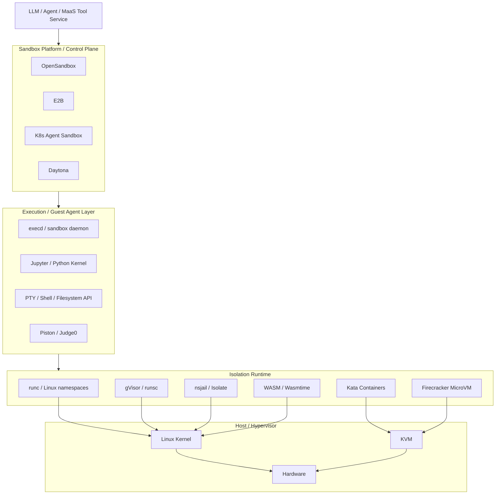
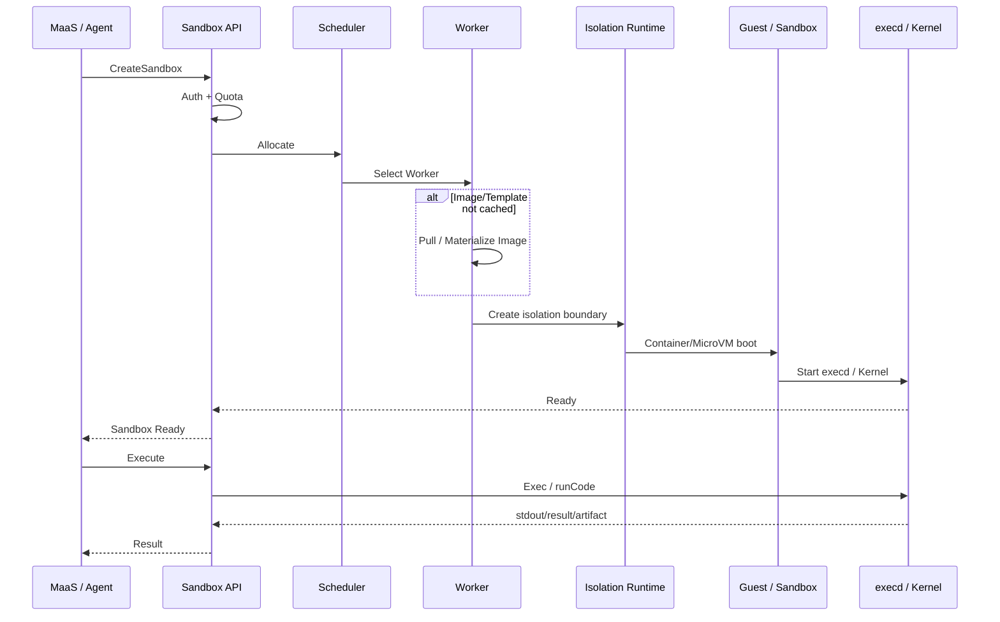
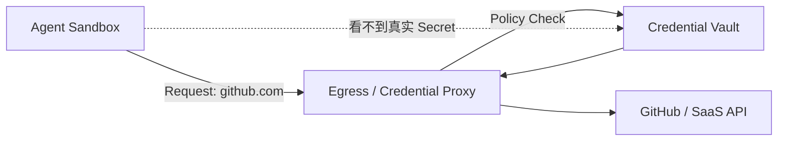
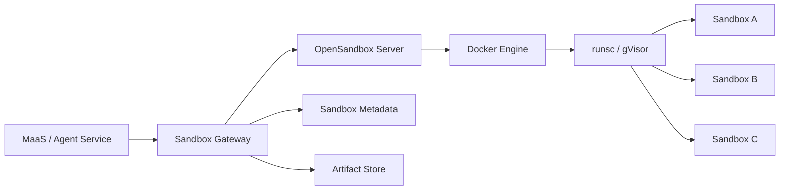
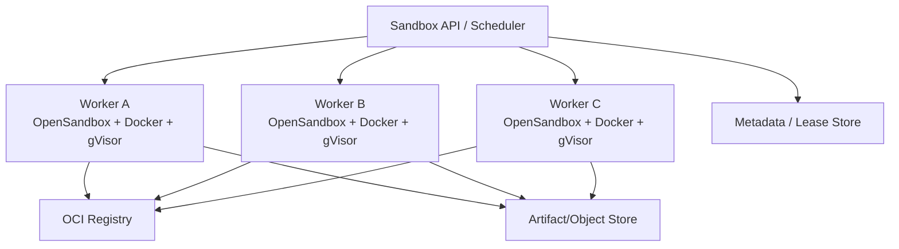
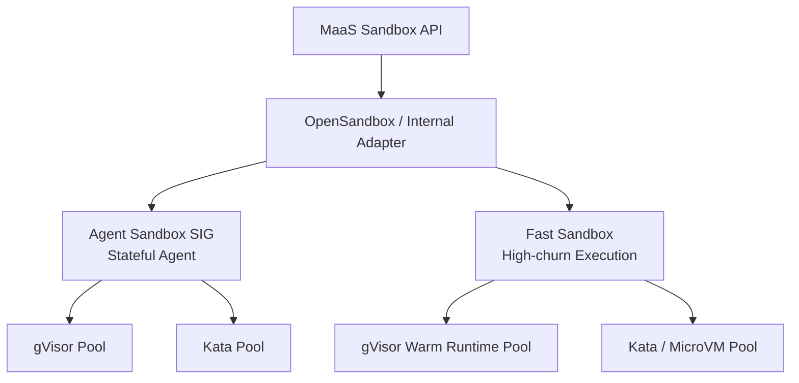
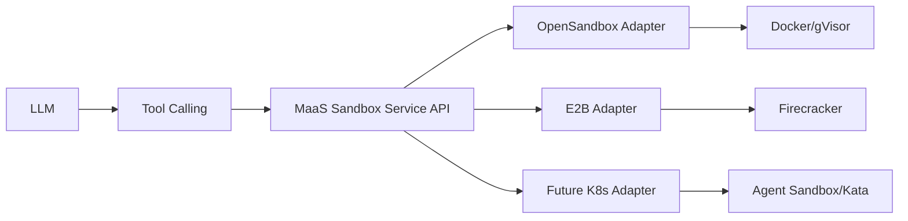
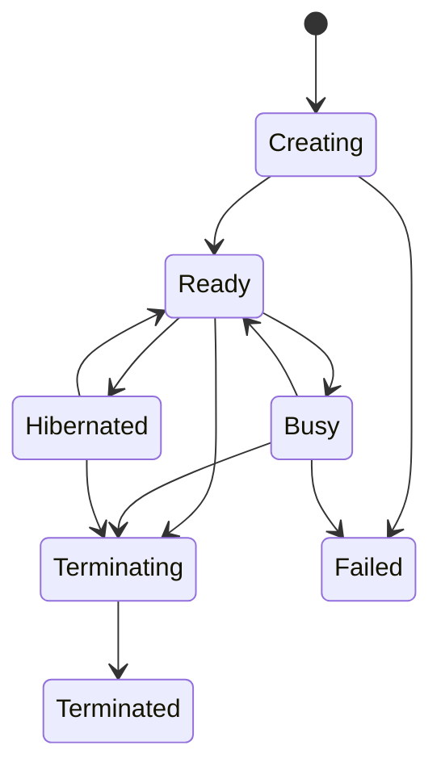
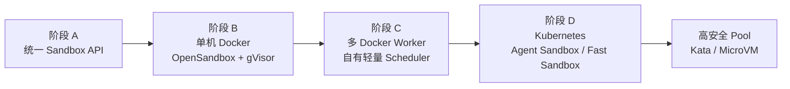

# 面向 Agent Sandbox 的开源沙箱技术生态、架构原理与工程选型

## Executive Summary

本报告以你当前的 **Docker-based MaaS 平台**为出发点，围绕 Agent Sandbox 而不是传统 Online Judge/Code Runner 做选型。研究边界与问题定义沿用你上传的研究需求：既关注控制平面、状态化 Agent Workspace、Warm Pool 和 Scale-out，也关注底层隔离运行时、代码执行与 MaaS Tool Calling 的接口边界。fileciteturn0file0

先给结论：

> **不要把“沙箱”选型理解成从 E2B、OpenSandbox、gVisor、Firecracker、Judge0 中选一个。它们处在不同层。**
>
> 对 MaaS/Agent 平台，更合理的架构是：
>
> **Sandbox Platform → Sandbox Executor / Guest Agent → Isolation Runtime**
>
> 上层解决生命周期、租户、Session、文件、网络、调度和 API；中层解决命令、Kernel、PTY、文件传输和富媒体结果；最底层才解决“恶意代码能否突破安全边界”。

截至 **2026 年 10 月 9 日**，几个对你的选型非常重要的行业变化是：

1. **OpenSandbox 已经成为目前最值得 Docker-first MaaS 重点 POC 的开源 Agent Sandbox Platform 之一。**它有 Docker 单机后端，也有 Kubernetes/Fast Sandbox 后端；Docker Backend 已能配置 CPU、内存、PID、capability、AppArmor、seccomp、Volume、网络和过期回收，并且可以在 Server 侧直接切换 gVisor 或 Kata，而 SDK/API 无需感知底层 runtime。OpenSandbox 当前约 1.56 万 GitHub Stars，Apache-2.0，项目仍快速活跃。citeturn13search9turn13search11turn13search3

2. **E2B 在 2026 年 9 月推出了 E2B Embed，这改变了它对“单机自托管”的适配度。**Embed 可以在一台 Linux+KVM 机器上用 Docker Compose 部署整个 E2B Runtime，每个 Sandbox 使用 Firecracker microVM，并复用 E2B Python/JS SDK；但 Embed 明确是 single-machine，且当前不含 secrets、volumes、workload identity 和 BYO proxy，多节点需转向 BYOC 等形态。citeturn19search5turn19search10

3. **Daytona 不再适合作为新的开源自托管底座。**官方仓库明确写明：自 2026 年 6 月起核心开发迁移到私有代码库，原公开仓库不再接收更新、修复和 release。因此它仍是优秀的架构参考——尤其是 Control Plane/Runner/Snapshot/Toolbox API——但对于“长期依赖开源、自托管、持续安全更新”的 MaaS，不应进入最终 Top 3。citeturn19search0turn19search2

4. **Kubernetes SIG Agent Sandbox 已快速成熟，但它是 Sandbox Orchestrator，不是 Isolation Runtime。**项目已经有 `Sandbox`、`SandboxTemplate`、`SandboxClaim`、`SandboxWarmPool`，Python/Go SDK、休眠、TTL、文件 API、Prometheus/OTel 等能力；其官方 Threat Model 明确要求不可信工作负载配合 gVisor/Kata 等 secure runtime。也就是说，引入 Agent Sandbox 并不会自动解决容器逃逸。citeturn14search0turn14search1turn14search14

5. **普通 Docker/runc 不建议作为公网、多租户、对抗性 Agent Code 的唯一安全边界。**Docker 本身提供 namespaces、cgroups、capabilities、seccomp、AppArmor/SELinux 等防护，但 workload 仍共享宿主 Linux kernel；gVisor 的设计目标正是把应用对宿主内核的直接 syscall 面隔开，而 Kata/Firecracker 则进一步提供独立 guest kernel/VM 边界。citeturn20search0turn20search2turn20search14turn16search0

因此，我的短期建议是：

**首选 POC：OpenSandbox + Docker Backend + gVisor/runsc。**

这是与你现有 Docker MaaS 技术栈耦合成本最低、同时可以显著强化隔离的一条路径。OpenSandbox 官方已经把 gVisor 做成 Server-level secure runtime；Docker Backend 会把 `runsc` 注入每个 sandbox，Client 不需要知道运行时发生了变化。citeturn13search1turn13search3

并行做两个对照实验：

**安全优先对照：E2B Embed + Firecracker。**

**轻量 MicroVM runtime 对照：Microsandbox。**

Microsandbox 是一个很有意思的“不是 Platform、而是可嵌入 MicroVM Runtime”路线：OCI-compatible、Linux/KVM、Snapshot/Fork、Python/Go/TS/Rust/CLI/MCP，且不要求常驻控制服务；但官方仍明确标记为 Beta，分布式 Control Plane 也不是其当前核心能力。citeturn16search1

短期**不建议仅为了 Sandbox 引入 Kubernetes**。Kubernetes 真正的价值会在你进入多节点、多租户、节点异构、Warm Pool、Quota、故障迁移、RuntimeClass、NetworkPolicy 和大规模调度后显现；在单节点阶段，它并不会替你解决最关键的“不可信代码隔离”问题。Agent Sandbox 自己也明确把强隔离交给 gVisor/Kata。citeturn14search1

长期推荐的目标形态则是：

> **MaaS Sandbox API → OpenSandbox/自有 Control Plane → Kubernetes Agent Sandbox 或 Fast Sandbox → gVisor / Kata / MicroVM**

其中：

- 长生命周期 Coding Agent / Workspace：偏向 **Agent Sandbox SIG**；
- 高频、短生命周期、大量 Sandbox/RL Rollout：偏向 **Fast Sandbox**；
- 普通风险租户：gVisor；
- 高风险、公网、多租户：Kata/MicroVM。

OpenSandbox 的 Fast Sandbox 官方文档也明确把两者定位为相邻而非替代：Fast Sandbox 以预热 Fastlet Pod 内的 runtime instance 为单位，强调高密度和高速创建；Agent Sandbox 以有状态 singleton Pod 为单位，强调 stable identity、持久化和 hibernation。citeturn13search0turn13search7

---

## 技术地图、安全边界与威胁模型

Agent Sandbox 技术的发展，基本可以看作四条技术线最终汇合：

**Online Judge / Process Jail → Container → Secure Container / MicroVM → Agent-native Stateful Sandbox Platform。**

传统 Judge0/Piston 更关注“提交一段代码，编译、运行、限制 CPU/内存、返回 stdout”；Agent Sandbox 则要额外解决 workspace、文件、网络、终端、多进程、浏览器、包安装、长期状态、Snapshot、Session affinity、Warm Pool 和租户生命周期。Judge0 自身定位仍是在线代码执行系统；Piston 的核心 API 也是 Execute/Interactive Execute，而 Kubernetes Agent Sandbox 和 OpenSandbox 的抽象已经明显转向有状态 Sandbox Workspace。citeturn17search1turn17search2turn14search0turn13search11

### 技术分层



这三个层次必须严格区分。

| 层次 | 解决的问题 | 典型对象 | 不负责什么 |
|---|---|---|---|
| **Sandbox Platform** | Create/Delete/TTL、租户、调度、Warm Pool、网络策略、Session、Snapshot、API/SDK | OpenSandbox、E2B、Agent Sandbox、Daytona | 通常不自己实现 CPU 虚拟化或内核隔离 |
| **Code Executor / Guest Agent** | exec、PTY、Kernel、stdout/stderr、文件、富媒体结果 | OpenSandbox execd、E2B Code Interpreter、Piston、Judge0、Jupyter | 不等于强安全边界 |
| **Isolation Runtime** | syscall、kernel、VM、namespace、resource isolation | runc、gVisor、Kata、Firecracker、nsjail、WASM | 不负责 SaaS 生命周期、租户和分布式调度 |

OpenSandbox 的架构就是典型例子：其协议把 lifecycle、exec 和 egress API 分开，Docker/Kubernetes/Fast Sandbox 是 runtime backend，而 sandbox 内运行 `execd` 提供执行与文件能力。citeturn13search11turn2search19

### Agent Sandbox 的核心威胁模型

对 MaaS 来说，“LLM 生成代码”应该默认按照 **潜在恶意 workload** 建模，而不能按照“模型应该不会故意攻击系统”建模。Kubernetes Agent Sandbox 官方 Threat Model 同样把 Sandbox Pod 定义为可能运行不可信 LLM-generated code，并明确列出 container escape、cross-tenant network attack、Kubernetes API abuse、DoS 和 Router SSRF 等风险。citeturn14search1

| 威胁 | Agent 中典型表现 | 推荐控制 |
|---|---|---|
| Host Escape | Agent 生成 exploit、滥用 syscall/kernel bug | gVisor 或独立 VM kernel；高风险用 Kata/Firecracker |
| Resource DoS | fork bomb、OOM、磁盘打满、stdout 无限输出 | cgroups v2、PID/file/output/time limit |
| Cross-Tenant | 扫描同机 sandbox、偷 workspace | 每租户/Session 独立 sandbox + 网络 deny |
| Metadata/内网 SSRF | 请求 `169.254.x.x`、Redis、DB、MaaS Control Plane | 私网 CIDR/metadata deny，Egress proxy |
| Secret Leakage | `env`/文件中直接拿 API Key | Credential Broker / destination-bound secret |
| Control Plane Attack | sandbox 访问 Docker socket/K8s token | 禁止 mount daemon socket；SA token 默认关闭 |
| Reuse Leakage | Warm sandbox 被 B 用户拿到 A 数据 | identity-aware reset；跨租户不复用 dirty sandbox |
| Provision DoS | 大量 Create Sandbox | tenant quota、rate limit、queue、pool upper bound |

Agent Sandbox 的 managed NetworkPolicy 默认设计值得直接借鉴：仅允许 Router ingress；egress 可访问公网，但阻断 RFC1918 私网和 cloud metadata；通过 `SandboxTemplate` 创建的 Pod 默认 `automountServiceAccountToken=false`。citeturn14search1

### 建议的风险等级

| 风险级别 | 工作负载 | 最低建议隔离 | 建议 |
|---|---|---|---|
| **R0** | 自己团队可信代码、开发测试 | hardened runc | rootless/userns、drop caps、seccomp、RO FS、quota |
| **R1** | 已认证用户、低攻击动机 Agent | **gVisor** | Docker+runsc 是很好的复杂度/安全折中 |
| **R2** | 公网 MaaS、任意模型生成代码、多租户 | **gVisor 最低；MicroVM 优先** | Egress deny、metadata deny、secret broker |
| **R3** | 企业敏感数据、恶意租户假设、强合规 | **Kata/Firecracker/MicroVM** | 独立 guest kernel；最好独立节点池/租户池 |

这里的关键不是“Docker 不安全”，而是**安全边界不同**。Docker 依靠 namespace、cgroup、capability、seccomp 等缩小权限，但宿主 kernel 仍是共同 TCB；Docker 官方也强调 Docker daemon 本身具有极高权限，不能让不可信 workload 访问 Docker socket。citeturn20search0turn20search5turn20search11

gVisor 则把 Linux-like application kernel（Sentry）移到 userspace，每个 sandbox 拥有独立 Sentry，降低 workload 直接触达 host kernel 的 syscall attack surface；代价是 syscall、文件和网络 I/O 需要经过更多层。citeturn20search2turn20search14turn20search16

---

## 开源项目生态与统一项目档案

为了保持表格可读性，下面将同一套项目档案字段拆成三张表；**行保持完全一致**。其中资源和启动延迟只填写有可追溯官方数据的内容，没有统一测试的数据一律标记“待 POC”。

### 项目生态、成熟度与部署

| 项目 | 项目定位 | 社区生态 / 成熟度 | License | 部署形态 | 主要第三方依赖 |
|---|---|---|---|---|---|
| **OpenSandbox** | Agent Sandbox Platform | 约 15.6k Stars；2026-09 仍活跃；发展很快 | Apache-2.0 | Docker 单机；K8s；Fast Sandbox | Docker 或 K8s；secure runtime 可选 | citeturn13search9turn13search11 |
| **E2B** | Agent Sandbox Platform + MicroVM Infra | E2B 主仓约 14.1k Stars；活跃 | Apache-2.0 | Cloud、BYOC、Embed 单机 Docker Compose/K8s | Linux+KVM、Firecracker；Embed 内置 DB/服务栈 | citeturn19search5turn19search9turn19search10 |
| **Daytona** | Agent Sandbox Platform | 历史社区很大，但 **2026-06 起 OSS Core 停止维护** | 冻结 core 依 LICENSE；当前 clients 为混合许可，CLI AGPL-3.0、其余主要 Apache-2.0 | 当前产品以 Daytona 托管/BYOC 为主；旧 OSS 不宜新建生产基础设施 | Redis、PostgreSQL、OIDC、S3-compatible store、OCI Registry 等 | citeturn19search0turn19search2turn20search6 |
| **K8s Agent Sandbox SIG** | Kubernetes-native Sandbox Orchestrator | ~4.2k Stars；SIG Apps；2026 活跃，API 已进入 v1beta1 | Apache-2.0 | Kubernetes only | K8s API、Controller、Router；StorageClass 可选 | citeturn14search0turn14search2turn14search14 |
| **Microsandbox** | Embeddable MicroVM Runtime / Library | ~8.5k Stars；活跃但官方明确 **Beta** | Apache-2.0 | Linux/KVM；Apple Silicon；Windows WHP；嵌入进程 | KVM/WHP/Apple Hypervisor，libkrun/smoltcp | citeturn16search1 |
| **Piston** | 多语言 Code Executor | ~2.8k Stars；成熟的小型执行引擎 | MIT | Docker / Compose | Docker、Node、cgroup v2、Isolate | citeturn17search2 |
| **Judge0** | Online Judge / Code Execution Service | ~4.5k Stars；2016 至今；生态成熟 | GPL-3.0 | Docker Compose | Docker、Redis、PostgreSQL、Isolate、Rails | citeturn17search1turn17search6 |
| **nsjail** | Linux Process Sandbox | Google 长期维护的低层隔离工具 | Apache-2.0 | Linux host process | namespaces、cgroups、seccomp/Kafel | citeturn7search2turn16search11 |
| **gVisor** | Secure OCI Runtime | 成熟、活跃；runsc 直接集成 Docker/K8s | Apache-2.0 | Docker/runsc、containerd、K8s | Linux；可用 systrap/KVM platform | citeturn20search2turn3search2 |
| **Kata Containers** | VM-backed OCI Runtime | ~8k+ Stars；4.0 已切 runtime-rs 默认 | Apache-2.0 | containerd/K8s；Docker 可用但 4.0 官方主要测试 QEMU | KVM + QEMU/Cloud Hypervisor/Dragonball + containerd shim | citeturn18search0turn18search2 |
| **Firecracker** | MicroVM VMM | ~37k Stars；长期活跃 | Apache-2.0 | Linux/KVM；需自行构建 orchestrator 或通过 E2B/Kata 等使用 | KVM、guest kernel/rootfs、网络/tap、jailer | citeturn16search0turn16search3 |
| **Wasmtime/WASI** | Capability-oriented WASM Runtime | ~18.7k Stars；Bytecode Alliance；成熟 | Apache-2.0 | Standalone / Embedded | 无 VM；依赖 host embedding/WASI 能力 | citeturn18search1 |

一个非常重要的筛选结果是：

**Daytona 的架构仍值得学习，但它已经不满足“持续维护的开源自托管底座”这个硬门槛。**其官方文档仍展现了很成熟的 Control Plane/Compute Plane 设计：API 内有 Sandbox Manager，Runner 从控制面拉取 job，Snapshot Store 使用 OCI Registry + S3-compatible storage，Sandbox Daemon 提供 Filesystem/Git/Process/Code Execution/Terminal 等 Toolbox API；但这些“当前产品能力”不能再等同于“当前可维护 OSS 能力”。citeturn19search0turn19search2

### 隔离、资源、启动和 Runtime 能力

| 项目 | 安全隔离方式 | 资源占用 | 启动延迟 | 可配置性 | Runtime / 多语言 | 生命周期与状态 |
|---|---|---|---|---|---|---|
| **OpenSandbox** | Docker+runc；Docker/K8s 可选 gVisor/Kata；FC 为 K8s 路径 | Platform/单 sandbox 无统一公开可比值，**待 POC** | Docker E2E 未统一公开；Fast Sandbox 特定实验 runc RuntimeReady p50≈72.7ms，Kata-FC≈559.6ms，N=20，不是生产 SLA | CPU/mem/GPU/PID/cap/seccomp/AppArmor/network/volume/runtime/TTL | Command、FS、Code Interpreter、自定义镜像 | create/exec/expiry/snapshot；Docker 重启可恢复 managed timer | citeturn13search0turn13search3turn13search11 |
| **E2B** | 每 Sandbox Firecracker microVM | E2E 单 sandbox **待 POC** | Embed 未给统一 E2E SLA；模板/Snapshot 体系降低启动路径 | Template、CPU/RAM、FS、网络等；Embed 某些 enterprise feature 缺失 | 通用 Linux；Code Interpreter Python/JS | create/connect/pause/snapshot 等；Embed 本地模板/日志 | citeturn19search5turn19search10 |
| **Daytona** | 当前文档描述独立 sandbox 和 namespaces/dedicated resource；旧 OSS 与当前闭源产品需区分 | 待 POC | 旧 OSS 宣传 `<90ms`，不应当成现有自托管保证 | 很强 | Python/TS/JS + 通用进程/Toolbox | Pause/Resume/Snapshot/Persistence | citeturn19search2turn19search3 |
| **Agent Sandbox SIG** | 本身不提供隔离；通过 RuntimeClass 用 gVisor/Kata | 取决于 Pod/runtime，待 POC | Warm Pool 官方强调近即时；示例给出 warm <2s、cold 10–30s，环境相关 | PodTemplate、resource、volume、runtimeClass、TTL、network policy | 取决于镜像；Python Runtime 示例；command/files API | Sandbox/Claim/WarmPool、hibernate/resume、PVC、TTL | citeturn14search0turn15search10 |
| **Microsandbox** | 一 workload 一 microVM，硬件虚拟化 | 官方未给跨平台统一 idle RSS；待 POC | 官方宣称平均 guest boot <100ms，但脚注明确是 M1 测量，不可泛化 | OCI image、volume、network、secret、snapshot | 标准 Linux OCI 镜像，因此 guest 内语言灵活 | Create/Exec/Fork/Snapshot/Restore | citeturn16search1 |
| **Piston** | Isolate：namespace/chroot/unprivileged user/cgroup | 待 POC | 每 submission 启动，未发布统一 E2E | runtime package、time/memory/process/output | 大量语言 package | submission/interactive process；不是长期 Workspace | citeturn17search2 |
| **Judge0** | Isolate + Docker | 待 POC | 未发布统一 Agent E2E | CPU/memory/time/compiler options | 90+ languages | Submission 状态；不擅长长期 session | citeturn17search1 |
| **nsjail** | Namespace+cgroup+seccomp+chroot/pivot_root | 很低，但具体 workload 待测 | Process-level，通常无需 VM boot；具体待 POC | 很强但低层 | 与宿主准备的 runtime 绑定 | process lifecycle；无 Session Platform | citeturn7search2 |
| **gVisor** | Userspace application kernel Sentry + Gofer | 官方强调无“大型固定 VM overhead”；具体需 POC | 容器级快速启动，具体 workload 待测 | OCI runtime 参数 | Linux ABI 高兼容但并非所有 syscall | OCI lifecycle；支持 checkpoint/restore 能力 | citeturn20search2turn20search16 |
| **Kata** | 独立 guest kernel + hardware virtualization | 无可信统一当前值；待 POC | Hypervisor/kernel/rootfs 影响显著，待 POC | VM/runtime/FS/network/VFIO 丰富 | 高 Linux 兼容 | OCI/containerd lifecycle | citeturn18search0turn18search2 |
| **Firecracker** | KVM MicroVM + minimal VMM/device model | 官方规格：1vCPU/128MiB guest 时 VMM threads overhead ≤5MiB | 官方规格：InstanceStart → guest `/sbin/init` ≤125ms；**不是 Sandbox E2E** | CPU/memory/block/net/vsock/rate limit | Guest Linux 内语言不限 | VM lifecycle、snapshot；上层需自己构建 | citeturn16search0turn16search3 |
| **Wasmtime/WASI** | WASM memory/capability boundary | 通常高密度；必须本机测 workload | 实例化通常非常轻，但无可直接与 Linux Sandbox 比的统一 E2E | fuel/epoch/memory/WASI capability | **Guest 必须是 WebAssembly/WASI**；Python/Go 等列表主要是 host embedding SDK | Module/instance lifecycle，而非 Linux Workspace | citeturn18search1 |

这里尤其要避免三个常见“benchmark 陷阱”。

**第一，Firecracker 的 `≤125ms` 是从 `InstanceStart` 到 guest `/sbin/init`，不是 `POST /sandbox` 到 Python 第一行代码返回。**Firecracker 的 VMM startup、rootfs 准备、网络、guest daemon、Python/Jupyter init 都可能继续累加。citeturn16search0

**第二，OpenSandbox Fast Sandbox 的约 72ms/560ms 是特定环境下的 `RuntimeReady` boundary。**官方甚至明确要求性能报告注明 commit、host、cache state、concurrency、completion boundary 和 percentile；这正是你自己的 POC 应该采用的严谨方式。citeturn13search0

**第三，Microsandbox 的 `<100ms` 官方脚注是 M1 guest boot 数据。**它不能直接预测 Linux KVM + Python Agent 的端到端 create latency。citeturn16search1

### Scale-out、Client、可观测性与工程难度

| 项目 | Scale-out | Client 接入 | 可观测性 | 运维复杂度 | 二次开发 | 已知限制 / 选型判断 |
|---|---|---|---|---|---|---|
| **OpenSandbox** | Docker backend 主要单机；长期 K8s/Fast Sandbox | Python/JS/Java/Kotlin/.NET/Go；OpenAPI；CLI/MCP | 生命周期/服务日志；可自行统一 OTel | **低→中** | **低→中**，协议和 backend 边界清楚 | 当前最契合 Docker-first → K8s 演进；性能仍需实测。citeturn13search8turn13search11 |
| **E2B** | Embed 单机；多机走 BYOC/其他部署 | Python/JS SDK、Code Interpreter/Desktop SDK | Embed 原生 OTel export | **中→高** | 中 | KVM 强依赖；Embed 不含 secrets/volumes/workload identity/BYO proxy。citeturn19search5 |
| **Daytona** | Runner 横向扩展、Region 架构成熟 | API、Toolbox、SDK、CLI | logs/analytics | 高 | 旧代码可 fork 但长期成本极高 | **开源 Core 停止维护，淘汰作为绿地 OSS 基座**。citeturn19search0turn19search2 |
| **Agent Sandbox SIG** | 原生 K8s；WarmPool；多 Pool shard | Python/Go SDK、K8s API、Router/MCP | Prometheus controller metrics + SDK OTel | **当前对你高** | 中 | 最适合长期 K8s；不是 secure runtime。citeturn14search7turn14search12 |
| **Microsandbox** | 暂无成熟分布式 Control Plane，需要上层构建 | Rust/TS/Python/Go/CLI/MCP | metrics/logs API | 单机低 | 中 | Beta；很好的 MicroVM runtime POC，不宜现在直接承担 MaaS 全控制面。citeturn16search1 |
| **Piston** | API 实例外部扩展；无 Agent scheduler | HTTP + WebSocket；社区多语言 client | 基础日志 | 低→中 | 中 | `--privileged` 部署及 Isolate 模型需谨慎；不是 Stateful Agent Sandbox。citeturn17search2 |
| **Judge0** | worker 可扩展 | HTTP JSON + Python SDK/webhook | 基础 worker/API telemetry | 中 | 中 | 当前 CE 安装仍有 cgroup v1 历史包袱；更适合 Judge/one-shot。citeturn17search3turn17search6 |
| **nsjail** | 无 | CLI/config | logs | 低组件、高自研 | **高** | 只提供 primitive，共享 host kernel。citeturn7search2 |
| **gVisor** | 由 Docker/K8s/你的 scheduler 决定 | OCI/runsc | runtime monitoring/log | 低→中 | 中 | syscall/FS/network compatibility/perf 需压测。citeturn20search14turn20search16 |
| **Kata** | 由 containerd/K8s 决定 | OCI/containerd shim | Kata tooling；runtime-rs 监控体系仍演进 | **高** | 高 | 更适合成熟 containerd/K8s 环境；4.0 Docker 官方只明确测试 QEMU。citeturn18search0turn18search4 |
| **Firecracker** | **没有平台级 scale-out** | REST VMM API | VMM metrics/log | **非常高（直接用时）** | 非常高 | 不应在 MaaS 中直接“裸用”，除非准备自研 orchestrator。citeturn16search0turn16search3 |
| **Wasmtime** | 由 host application 调度 | Rust/C/C++/Python/.NET/Go 等 embedding API | host 自定义 | 低 | 中 | 不兼容通用 Linux Agent Workspace；适合受限 plugin/function。citeturn18search1 |

Piston 和 Judge0 的意义更像是**比较组**而非候选主平台。Piston 的执行安全模型包括默认禁网、不同 unprivileged user、namespace、process/file/memory/output/time 限制，很适合作为“一次性多语言代码执行”的实现参考；但没有 Workspace 生命周期、Snapshot、Agent Session、租户级 Sandbox API。citeturn17search2

Judge0 的历史安全事件也说明“网络策略”绝不是辅助功能：官方曾披露 <=1.13.0 的默认网络配置可通过 SSRF 链形成 Sandbox Escape，修复版本是 1.13.1。citeturn17search10

---

## 隔离运行时、启动路径与性能取舍

对于你的 MaaS，底层真正值得做 POC 的不是十几种 Runtime，而是四条路线：

**runc 基线 → gVisor → VM-backed Kata/Firecracker → WASM 特殊场景。**

| 维度 | Docker/runc | gVisor/runsc | Kata Containers | Firecracker | Wasmtime/WASI |
|---|---|---|---|---|---|
| Kernel | 与 Host 共享 | Host kernel + userspace Sentry | 独立 Guest Kernel | 独立 Guest Kernel | 无 Linux Guest Kernel |
| 主要边界 | namespace/seccomp/caps | syscall/application-kernel | hardware VM | KVM microVM | WASM capability/memory |
| Escape 后风险 | 直接面对 Host Kernel | 还需突破 Sentry/host sandbox | 需突破 Guest→Hypervisor | 需突破 Guest→VMM/KVM | 需突破 runtime/host capability |
| Linux 兼容 | 最高 | 高，但非完整 syscall | 很高 | 很高（Guest Linux） | **低：要求 WASM/WASI** |
| 冷启动 | 最低 | 低 | 中/高 | MicroVM 中较低 | 极低 |
| 空闲密度 | 高 | 高 | 较低 | 中高 | 很高 |
| syscall/FS 开销 | 最小 | 可能明显 | VM/virtio 开销 | VM/virtio 开销 | workload-dependent |
| Docker-first | ★★★★★ | ★★★★★ | ★★～★★★ | ★★ | ★★ |
| 强多租户 | ★★ | ★★★★ | ★★★★★ | ★★★★★ | ★★★★* |
| 运维复杂度 | 低 | 低～中 | 高 | 很高（裸用） | 中 |

\* WASM 的隔离模型可以很强，但它只适用于能被 WASM/WASI 表达的 workload，因此不能直接替代 Coding Agent 需要的 Linux Shell、apt/pip/npm、浏览器、任意 ELF、PTY 和 Docker 工具链。Wasmtime 文档中的 Rust/Python/Go/.NET 等“Language Support”主要指**宿主程序如何嵌入 Wasmtime**，而不是意味着沙箱里可以像 Linux 一样任意运行这些语言。citeturn18search1

### 为什么我认为 gVisor 是你短期的“甜点位”

你的现状已经有 Docker。因此：

```text
今天
dockerd -> runc -> container

升级 gVisor 后
dockerd -> runsc -> gVisor Sentry -> workload
```

应用镜像、Docker API、OCI workflow 基本保留，而 Host Kernel attack surface 明显下降。gVisor 官方甚至直接把 Docker 称为最快速的接入方式；OpenSandbox 也已经支持在 Docker 模式下把 `runsc` 作为 `docker_runtime` 注入。citeturn20search2turn13search3

最大的代价不是启动时间，而往往是 **syscall-heavy、filesystem-heavy、network-heavy workload 的性能和兼容性**。gVisor 的 filesystem 访问通过 Gofer 等额外层，官方也明确说明这种安全边界会带来额外成本。citeturn20search16

因此，你不能只 benchmark：

```python
print("hello")
```

而要重点测：

```text
pip install
npm install
git clone
大量 stat/open/read/write
Pandas / NumPy
解压缩
编译 Go/C++
Playwright / Browser
PTY / shell
大量短 TCP 请求
```

### 为什么 Firecracker 很吸引人，但不建议自己直接集成

Firecracker 本身的性能规格确实漂亮：官方测试承诺在特定硬件条件下，VMM threads 对 1vCPU/128MiB microVM 的额外内存 ≤5MiB，`InstanceStart` 到 guest `/sbin/init` ≤125ms。citeturn16search0

但是从 Firecracker 到“Agent Sandbox Service”，中间还缺：

```text
Image -> RootFS
Guest Kernel
Snapshot 管理
TAP / Network namespace
IPAM
NAT / Egress
vsock
Guest Agent
Exec / PTY
File API
Volume
Secret broker
TTL
Scheduler
Pool
Quota
Multi-tenancy
Metrics
Failure Recovery
```

所以更合理的做法是**消费 Firecracker 的上层封装**——例如 E2B、Microsandbox，或者未来 Kata/Fast Sandbox 的相关路径——而不是自己从 VMM 开始造完整平台。

### 端到端启动延迟应该怎样测



建议采用：

\[
T_{ready} =
T_{api}
+T_{auth}
+T_{schedule}
+T_{image}
+T_{provision}
+T_{isolation}
+T_{guest}
+T_{execd}
+T_{health}
\]

Code Interpreter 用户真正感受到的是：

\[
T_{tool} =
T_{ready}
+T_{kernel-init}
+T_{code-exec}
+T_{result}
\]

所以一定要分别报告：

| 指标 | 起点 | 终点 |
|---|---|---|
| VMM Boot | Runtime Start | Guest init |
| Sandbox RuntimeReady | Create runtime | Isolation runtime ready |
| Sandbox Ready | API Create | execd health ready |
| First Exec | API Create | `print(1)` result |
| Reused Exec | Execute | result |
| Warm Claim | Claim | existing sandbox Ready |
| Snapshot Restore | Restore request | first executable command |

否则会出现典型误导：

> “Firecracker 125ms” → 被写成 → “Agent Sandbox 冷启动 125ms”。

这两者并不是同一个指标。Firecracker 官方规格本身就明确了其测量边界。citeturn16search0

---

## Agent Runtime、部署形态与 Scale-out 架构

对于 Agent，最大的设计变化其实不是隔离，而是 **Sandbox 从 Job 变成 Session/Workspace**。

### Stateful 与 One-shot 不应该二选一

推荐把 Sandbox 作为长期 workspace 边界，同时在内部同时提供两种执行语义：

| 模式 | Stateful Kernel | One-shot Process |
|---|---|---|
| 典型接口 | `runCode(context_id, code)` | `exec(argv)` |
| 状态 | 保存 Python variable/module state | 每个进程独立 |
| 适合 | Code Interpreter、Data Analysis | shell、build、git、工具 |
| 复现性 | 较弱 | 强 |
| 并发语义 | 通常需串行化同一 Kernel | 可多个 process |
| 泄漏风险 | 高于 one-shot | 较低 |
| 生命周期 | Conversation/Sandbox | Command |

建议：

```text
Conversation
   │
   └── Sandbox
         ├── /workspace
         ├── shell processes
         ├── Python Kernel context
         ├── downloaded files
         └── generated artifacts
```

而不是：

```text
每一次 Tool Call
   └── 创建全新 Sandbox
```

这样 Agent 多轮执行时才能自然支持：

```python
df = pd.read_csv(...)
# 第二个 Tool Call
df.describe()
# 第三个 Tool Call
plt.plot(...)
```

同时 Shell、`git clone`、编译、browser 等仍使用独立 process。

### Artifact 不应依赖 Sandbox 生命周期

推荐把文件分成两类：

```text
Ephemeral Workspace
/workspace/*
      │
      ├── 中间代码
      ├── package cache
      └── temporary files

Durable Artifact Store
      │
      ├── report.pdf
      ├── chart.png
      ├── result.csv
      └── artifact manifest
```

Artifact 最终上传 Object Storage，元数据至少保存：

```text
tenant_id
conversation_id
sandbox_id
execution_id
artifact_id
content_type
size
sha256
created_at
retention_policy
```

这样 Sandbox TTL、hibernate、node failure 不会导致用户输出消失。

### 网络和 Agent Tool Call

我建议不要把所有 API Key 注入 Sandbox 环境变量。

更安全的模型是：



这与 Agent Sandbox 官方“默认阻断私网和 metadata”的安全理念一致，也与现代 Sandbox 平台逐渐采用的 credential proxy 思路一致。citeturn14search1

对于模型调用本身，我更推荐：

```text
Sandbox
   ↓
Tool Broker / MCP Gateway
   ↓
MaaS / External API
```

而不是直接向 Sandbox 暴露 MaaS 的 master credential。

### Warm Pool 一个经常被忽视的限制

**预热与动态配置天然冲突。**

Kubernetes Agent Sandbox 当前 Python SDK 明确指出：如果 Claim 设置了 per-claim `env` 或 `volume_claim_templates`，就不能直接 adopt 已经预热好的 Sandbox，而会强制 cold start。citeturn15search3

其 OpenClaw 示例也明确警告：Claim 动态添加 VolumeClaimTemplate 会绕过预热池并 cold-start；一些 Template 甚至直接把这种配置标记为 Disallowed。citeturn15search9

因此你的 Pool 不能设计成：

```text
一个 universal pool
    ↓
创建时任意变 image/env/runtime/volume/network/CPU/GPU
```

更合理的是**规格化池**：

```text
python-small-gvisor
python-large-gvisor
python-small-kata
node-small-gvisor
browser-medium-kata
coding-agent-medium-gvisor
```

Pool key 可以定义为：

\[
PoolKey =
hash(
Image,\ Runtime,\ CPU,\ Memory,\ NetworkProfile,\ ExecutorVersion
)
\]

动态 Secret、用户身份等尽量在**领取之后通过 Guest Agent / Credential Broker** 注入，而不是改变 Pod/VM 模板。

### 四种部署形态

| 形态 | 架构 | 优势 | 问题 | 你的阶段 |
|---|---|---|---|---|
| 单机 Docker Worker | API → Docker → runsc | 极简 | 单节点 | **现在最佳** |
| Docker 多 Worker | CP → Scheduler → N×Docker Worker | 无 K8s | 自己做资源调度/故障处理 | **很好的中间态** |
| Kubernetes-native | CP/CRD → K8s Scheduler → RuntimeClass | 调度/Quota/NetworkPolicy/HA 成熟 | 运维栈显著增大 | 长期 |
| MicroVM Cluster | Scheduler → Firecracker Hosts | 强隔离/高控制力 | 平台研发量最大 | 除非 Sandbox 是核心产品，否则不建议自研 |

短期架构建议：



OpenSandbox 的 Docker backend 本身就是定位为 local/single-host backend，并直接管理 container、timer、label、volume、port、snapshot 和 network policy；因此和你目前的基础设施非常贴合。citeturn13search11

中期即使仍不引入 Kubernetes，也可以演进成：



这里控制平面只需自己增加：

```text
Worker Registry
Resource Heartbeat
Placement
sandbox_id -> worker_id
Lease
Quota
Drain
Failure Detection
```

这样你可以把 Kubernetes 延后，而不是在第一天同时引入 K8s、Agent Sandbox、Kata、CNI、StorageClass 等一整套新栈。

### 什么时候值得迁 K8s

出现这些特征后，迁移开始有明显收益：

- >10 台 Sandbox Worker；
- 多种 CPU/GPU/VM runtime 节点池；
- 数百到上千长期 Sandbox；
- 大规模 Warm Pool；
- 多租户资源配额；
- 节点自动扩缩容；
- Sandbox Pod NetworkPolicy；
- RuntimeClass；
- Zone-aware storage；
- 节点 drain/升级需求。

Agent Sandbox 官方性能文档已经讨论了 >1000 replica Warm Pool 和 10–30+ claim/s 场景下 kube-apiserver throttling、watch starvation、pool sharding 和 refill pacing；这说明 Kubernetes 能承载这一规模，但 Kubernetes control plane 本身也会成为需要调优的资源。citeturn15search2

长期可变为：



Fast Sandbox 2026 年公开工程测试中，在特定 warm single-node 环境下，runc `RuntimeReady` p50 约 72.7ms，Kata Firecracker 约 559.6ms；更重要的是它通过预热 Fastlet 规避“每个 Sandbox 都完整走一遍 Kubernetes Pod scheduling”的关键路径。citeturn13search0

### Capacity Planning

单节点最大并发可以先用：

\[
C_{mem}
=
\left\lfloor
\frac{
M_{node}-M_{reserve}-M_{platform}
}{
M_{sandbox}
}
\right\rfloor
\]

\[
C_{cpu}
=
\left\lfloor
\frac{
CPU_{allocatable}\times O_{cpu}
}{
CPU_{sandbox,avg}
}
\right\rfloor
\]

最终：

\[
C_{node}
=
\min(
C_{mem},
C_{cpu},
C_{pid},
C_{disk},
C_{network}
)
\]

其中 `O_cpu` 是你允许的 CPU oversubscription factor。

例如仅作为计算示范，假设：

```text
Node RAM       = 128 GiB
Host reserve   = 16 GiB
Platform       = 4 GiB

POC 实测每 sandbox：
working set    = 768 MiB
runtime extra  = 64 MiB
```

则：

\[
C_{mem}
=
\lfloor
108GiB / 832MiB
\rfloor
\approx132
\]

如果 CPU 模型只能支持 100 个并发工作 Sandbox，那么实际 capacity 应取 **100，而不是 132**。

Warm Pool 可以用 Little's Law 建立第一版估计：

\[
N_{active}\approx \lambda \times E[S]
\]

并用 provisioning window 粗估最小缓冲：

\[
N_{warm}
\approx
\lceil
\lambda_{peak}
\times
T_{cold}
\times
SafetyFactor
\rceil
\]

例如纯算法演示：

```text
峰值 create rate = 8/s
Cold provision    = 0.4s
Safety factor     = 3
```

则：

\[
N_{warm}
=
\lceil8\times0.4\times3\rceil
=10
\]

这里的 `0.4s` 不是行业 benchmark，必须替换成你自己的 P95 cold-start 数据。

---

## Sandbox API、MaaS 接入边界与控制平面设计

我强烈建议在 MaaS 内部定义自己的 **Sandbox Abstraction API**，而不是让 Tool Service 直接 import E2B/OpenSandbox/Daytona SDK。

目标结构：



这样你以后从：

```text
OpenSandbox Docker + gVisor
```

迁移到：

```text
OpenSandbox Kubernetes + Kata
```

甚至：

```text
Agent Sandbox SIG
```

模型层和 Tool Calling 协议都无需改变。

OpenSandbox 自己已经采用类似思想，将 lifecycle、exec、egress 拆成独立 OpenAPI surface，因此很适合作为你内部 abstraction 的设计参考。citeturn2search19turn13search11

### 最小公共 API

| API | 建议语义 |
|---|---|
| `POST /v1/sandboxes` | Create Sandbox |
| `GET /v1/sandboxes/{id}` | Get 状态 |
| `GET /v1/sandboxes` | List |
| `POST /v1/sandboxes/{id}/executions` | Exec command / code |
| `GET /v1/.../executions/{eid}` | Get Result |
| `GET /v1/.../executions/{eid}/stream` | SSE / WS Stream |
| `POST /v1/sandboxes/{id}/files` | Upload |
| `GET /v1/sandboxes/{id}/files` | Download |
| `POST /v1/sandboxes/{id}:renew` | Renew TTL |
| `POST /v1/sandboxes/{id}:hibernate` | Optional |
| `POST /v1/sandboxes/{id}:resume` | Optional |
| `DELETE /v1/sandboxes/{id}` | Terminate |

建议 Create 请求不要直接暴露底层 vendor：

```json
{
  "template": "python-data-small",
  "isolation_profile": "strong",
  "resources": {
    "cpu": 2,
    "memory_mb": 2048
  },
  "network_profile": "internet-allowlist",
  "ttl_seconds": 1800,
  "session": {
    "conversation_id": "conv_xxx"
  }
}
```

而由服务端映射：

```text
isolation_profile = standard
    -> gVisor

isolation_profile = strong
    -> Kata / Firecracker

isolation_profile = trusted
    -> runc
```

这样上层不会出现：

```json
{
  "runtime": "kata-qemu"
}
```

这种把 infra implementation 泄漏给 MaaS Tool 的设计。

### Execution API 应同时支持 Command 与 Kernel

建议：

```json
POST /sandboxes/{id}/executions
{
  "type": "command",
  "argv": ["python", "script.py"],
  "timeout_ms": 30000
}
```

和：

```json
{
  "type": "code",
  "language": "python",
  "context_id": "python-default",
  "code": "df.describe()"
}
```

统一返回：

```json
{
  "execution_id": "exec_xxx",
  "status": "completed",
  "exit_code": 0,
  "stdout": "...",
  "stderr": "",
  "results": [],
  "artifacts": [],
  "metrics": {
    "wall_time_ms": 132,
    "cpu_time_ms": 91,
    "peak_memory_mb": 123
  }
}
```

Code Interpreter 再增加：

```text
text
markdown
json
html
png
svg
jpeg
pdf
```

等富媒体 result。

### REST、gRPC、SSE 与 WebSocket 的角色

我建议：

```text
External MaaS Client
       │
       │ REST
       ▼
Sandbox Control Plane
       │
       ├── gRPC -> Worker
       │
       ├── SSE  -> stdout/stderr stream
       │
       └── WS   -> interactive PTY / terminal
```

REST 适合 lifecycle，因为天然容易调试、代理和做 OpenAPI；gRPC 适合内部 Scheduler→Worker 的高频 RPC；SSE 非常适合单向日志/执行输出；WebSocket 留给 PTY、stdin/stdout 双向终端。

### 生命周期建议



MaaS 侧推荐：

```text
Conversation ID
       ↓
Sandbox Lease
       ↓
多个 Tool Calls
       ↓
idle TTL
       ↓
Hibernate / Delete
```

不要让 LLM 自己决定何时创建/删除 infrastructure；这些是 Tool Runtime Policy。

---

## POC、Benchmark 与数据采集计划

POC 不应比较十几个项目。第一轮我建议只做 **四条路径**：

| Candidate | 目的 |
|---|---|
| **A. OpenSandbox + Docker/runc** | Baseline |
| **B. OpenSandbox + Docker/gVisor** | **主候选** |
| **C. E2B Embed + Firecracker** | 强隔离 MicroVM 对照 |
| **D. Microsandbox** | Lightweight MicroVM Runtime 对照 |

Piston 可以作为“one-shot multi-language executor baseline”，但不需要参与 Agent Platform 总评分。

Judge0 不建议与你主机共用同一 POC 环境，因为当前官方 CE v1.13.1 安装说明仍要求 Ubuntu 22.04 将 unified cgroup hierarchy 关闭以适配其隔离体系，这与你希望采用现代 cgroup v2 的 MaaS Host 方向相冲突。citeturn17search3turn17search6

### POC 基础环境

建议至少准备两台完全一致的裸机：

| 项目 | 建议 |
|---|---|
| CPU | x86_64，支持 VT-x/AMD-V |
| CPU 数 | ≥32 physical/logical cores，记录 topology |
| Memory | ≥128 GiB |
| Disk | NVMe SSD |
| Kernel | 同版本 Linux 6.x |
| cgroup | v2 |
| Docker | 相同 stable release |
| KVM | 开启 |
| OCI Registry | 你的私有 Registry |
| Network | 相同网段/带宽 |
| Clock | NTP 同步 |
| Monitoring | node exporter + cgroup stats + process RSS |

镜像必须保持一致：

```text
Ubuntu base
Python
Node.js
git
curl
gcc/g++
Go
NumPy
Pandas
Jupyter runtime
```

同时单独准备：

```text
minimal-python
data-science
coding-agent
browser-agent
```

四种 Template，以观察镜像体积对启动的影响。

### 启动实验

至少拆成：

| Test | Image Cache | Pool | Kernel | 测量 |
|---|---|---|---|---|
| Image Pull Cold | 无 | 无 | 无 | Create → Ready |
| Cached Cold | 有 | 无 | 无 | Create → Ready |
| Warm Pool | 有 | 有 | 已启动 | Claim → Ready |
| First Python | 有 | 可选 | 无 | Create → `print(1)` |
| Reused Python | 有 | 已存在 | 有 | runCode → result |
| Snapshot Restore | snapshot | 无 | snapshot | Restore → exec |
| Concurrent Create | 有 | 无/有 | 混合 | P50/P95/P99 |

每个 hot/warm test 建议：

```text
N >= 200
```

高并发稳定性：

```text
N >= 1000 operations
```

真正的 image-pull cold test 可以降低样本量，但必须单独报告，不能混进 warm 数据。

### Resource Density

依次保持：

```text
10
50
100
200
500
```

个 Idle Sandbox，记录：

```text
Host MemAvailable
Host RSS
cgroup memory.current
VMM RSS
Sentry RSS
Page Cache
CPU idle
PID count
Open FD
Disk overlay usage
Network namespace count
```

最重要的指标不是：

```text
container reported RSS
```

而是：

\[
MemoryCost_{sandbox}
=
\frac{
HostUsed(N)-HostUsed(0)
}{
N
}
\]

并分别测量：

```text
Ready Idle
Python Kernel Idle
After Pandas Import
After 100 MiB Workspace
```

### Agent workload benchmark

建议至少包含：

| Workload | 测什么 |
|---|---|
| `print(1)` × 1000 | RPC/exec 基础开销 |
| Python startup | interpreter startup |
| NumPy matrix | CPU |
| Pandas CSV | memory + FS |
| 10k small files | metadata syscall |
| `git clone` | network + FS |
| `pip install` | FS + network |
| `npm install` | syscall + small files |
| Go build | compile CPU/FS |
| C++ build | fork/exec/FS |
| 1 GiB sequential IO | FS throughput |
| 1000 HTTP requests | network |
| PTY session | interactive latency |

这一组尤其能暴露 gVisor 和 VM runtime 在不同 workload 下的真正成本。

### 安全验证

仅在隔离的 POC 节点执行无破坏性验证：

| 测试 | 验收 |
|---|---|
| `/proc` / host process 可见性 | 不可见 |
| Host filesystem | 不可读 |
| Docker socket | 不存在 |
| K8s token | 默认不存在 |
| RFC1918 scan | 被策略阻断 |
| Fake metadata service | 被阻断 |
| Sandbox A → B | 默认不可达 |
| CPU 无限循环 | quota 生效 |
| memory allocation | OOM 只杀 sandbox |
| fork bomb | PID quota 生效 |
| stdout bomb | 输出上限生效 |
| timeout | 强制终止 |
| TTL | 完整清理 |
| Dirty sandbox reuse | 不得跨 tenant 泄漏 |

Docker socket 尤其必须成为 hard gate；Docker 官方明确指出能够控制 daemon 的用户拥有极强宿主机能力。citeturn20search0turn20search11

### Benchmark 记录模板

| Candidate | Runtime | Image | Cache | Warm | Concurrency | N | Ready P50 | P95 | P99 | First Exec P95 | Idle Mem/SB | Peak Mem | Error % |
|---|---|---|---|---|---:|---:|---:|---:|---:|---:|---:|---:|---:|
| OpenSandbox | runc | python | cached | No | 1 | 200 |  |  |  |  |  |  |  |
| OpenSandbox | gVisor | python | cached | No | 1 | 200 |  |  |  |  |  |  |  |
| E2B Embed | Firecracker | python | cached | No | 1 | 200 |  |  |  |  |  |  |  |
| Microsandbox | MicroVM | python | cached | No | 1 | 200 |  |  |  |  |  |  |  |

每个结果必须绑定：

```text
git commit / release
kernel
CPU model
runtime version
image digest
cache state
pool state
concurrency
measurement boundary
sample N
```

统计至少输出：

\[
P50,\ P95,\ P99,\ Mean,\ StdDev,\ ErrorRate
\]

对于重要 P95/P99，建议再做 bootstrap 置信区间。

---

## 选型矩阵、Top 3 与演进路线

先设置**硬性准入条件**，再计算总分。否则某个已停止维护、但功能非常丰富的项目可能因为功能评分很高而错误胜出。

建议硬门槛：

```text
G1: 可以完整自托管
G2: 当前仍持续维护
G3: 能隔离不可信 workload，或可以接 secure runtime
G4: License 可被公司接受
G5: 不允许 sandbox 控制 Docker/K8s Host
G6: 能抽象成统一 Sandbox API
```

按照这些 gate：

| 项目 | Gate 结果 | 原因 |
|---|---|---|
| OpenSandbox | ✅ | 全部满足 |
| E2B | ✅ | Embed 开源、自托管、Firecracker |
| Microsandbox | ✅/⚠ | 满足 runtime 要求，但平台能力不完整 |
| Agent Sandbox SIG | ⚠ | 技术满足，但违反你短期“不引 K8s”约束 |
| Daytona OSS | ❌ | Core 停止维护 |
| Piston | ❌ 主平台 / ✅ Executor | Agent Sandbox 功能不完整 |
| Judge0 | ❌ 主平台 / ✅ Executor | Stateful Agent fit 低 |
| Firecracker | ❌ 主平台 / ✅ Runtime | 缺完整控制平面 |

Daytona 的 ❌ 是本轮研究最需要注意的“时效性结论”：官方已经明确公开 repo 不再获得 fixes/releases。citeturn19search0

### 架构适配评分示例

权重采用你的初始模型：

| 指标 | 权重 |
|---|---:|
| 安全隔离 | 20% |
| 部署与依赖 | 15% |
| 资源效率 | 15% |
| 启动性能 | 10% |
| 功能/可配置性 | 10% |
| Scale-out | 10% |
| API/SDK | 10% |
| 社区/可维护性 | 10% |

以下评分是**架构适配评分，而不是 Benchmark 结果**；资源与性能项在 POC 后必须用实测修正。

| Candidate | 安全 | 部署 | 资源 | 启动 | 配置 | Scale | API | 生态 | 加权 |
|---|---:|---:|---:|---:|---:|---:|---:|---:|---:|
| **OpenSandbox** | 4.0 | 5.0 | 4.0 | 4.0 | 5.0 | 5.0 | 5.0 | 4.5 | **4.50** |
| **E2B** | 5.0 | 3.5 | 3.5 | 4.5 | 4.5 | 4.0 | 5.0 | 4.5 | **4.30** |
| **Microsandbox** | 5.0 | 4.5 | 4.0 | 4.5 | 4.5 | 2.5 | 4.0 | 3.5 | **4.17** |
| Agent Sandbox SIG | 4.5 | 1.5 | 3.5 | 4.0 | 4.5 | 5.0 | 4.0 | 4.5 | **3.85** |
| Daytona OSS | 4.0 | 2.5 | 3.5 | 4.0 | 5.0 | 4.5 | 5.0 | 1.0 | **3.65** |
| Piston | 2.5 | 4.0 | 4.5 | 4.0 | 2.5 | 2.5 | 3.5 | 3.5 | **3.38** |
| Judge0 | 2.5 | 3.0 | 4.0 | 3.0 | 3.0 | 4.0 | 4.0 | 4.0 | **3.35** |

不要因为 OpenSandbox 总分最高就直接宣布完成选型。真正决定结果的 POC 是：

```text
OpenSandbox + gVisor
vs
E2B Embed + Firecracker
vs
Microsandbox
```

在你真实 Agent workload 下的：

```text
P95/P99 latency
idle sandbox memory
Python Kernel density
pip/npm/git performance
network overhead
failure recovery
security compatibility
运维成本
```

### 短期 Top 3

**Top 1 — OpenSandbox + Docker + gVisor**

这是我最推荐的落地方案。

原因不是它每个维度都绝对最强，而是**迁移摩擦最低**：

```text
你的现状
Docker
   ↓
OpenSandbox
   ↓
Docker Engine
   ↓
runsc/gVisor
```

同时得到：

```text
Sandbox Lifecycle
Exec/File API
Multi-language SDK
TTL
Volume
Network Policy
Code Interpreter
未来 K8s Backend
未来 Kata
```

而 OpenSandbox secure runtime 是 server-side 配置，后续从 gVisor 升级 Kata 不需要模型层修改。citeturn13search1turn13search3

**Top 2 — E2B Embed + Firecracker**

如果你的安全基线从第一天就是：

> “来自公网的任意用户代码必须拥有独立 guest kernel。”

那么 E2B Embed 甚至可能成为 Top 1。

优势：

```text
成熟 Agent Sandbox API/SDK
Firecracker
MicroVM/session
Template
Dashboard
OpenTelemetry
单机 Docker Compose
Apache-2.0
```

弱点是 KVM 和整体 stack 都比 gVisor-heavy Docker 更重，且 Embed 当前明确缺少 secrets、volumes、workload identity 和 BYO proxy；横向扩展也不能简单地把 Embed 复制成一个通用分布式 cluster。citeturn19search5

**Top 3 — Microsandbox**

值得把它看成：

> “如果我们不采用完整 Sandbox Platform，最值得研究的 MicroVM primitive 之一。”

优点是：

```text
Embeddable
OCI
MicroVM
Snapshot/Fork
无长期 server daemon 要求
Python/Go/TS/Rust/MCP
```

这特别适合你自己已有较成熟 Control Plane、只缺一个安全 Execution Runtime 的情况。

但它目前官方仍写着 Beta，所以我的建议是 **POC，而不是直接作为企业多租户唯一安全基础设施**。citeturn16search1

### 长期 Top 3

对于多节点、多租户、强隔离的目标：

**Top 1：OpenSandbox Control/API + Kubernetes/Fast Sandbox/Agent Sandbox Backend + gVisor/Kata**

这是长期架构上最有弹性的组合。

```text
MaaS
 ↓
Stable Internal Sandbox API
 ↓
OpenSandbox
 ├── Agent Sandbox → Stateful Agent Workspace
 └── Fast Sandbox  → High-throughput Execution
          ↓
   RuntimeClass
    ├── gVisor
    └── Kata
```

OpenSandbox 已经把 Docker 和 Kubernetes runtime abstraction 分开，因此这条迁移路径比从自研 Docker API 直接跳到 Kubernetes 要平滑。citeturn13search11turn13search4

**Top 2：Kubernetes SIG Agent Sandbox + Kata/gVisor + 自有 Executor**

如果未来你更希望依赖 Kubernetes 社区标准，而不是依赖某个 Sandbox Platform，那么这是最“基础设施原生”的路线。

它提供：

```text
Sandbox CRD
Template
Claim
WarmPool
Stable Identity
PVC
Hibernation
Go/Python Client
Metrics
```

但你仍然需要 Code Interpreter / execd / PTY / artifact 等 data plane。因此它更接近：

> Sandbox Orchestration Standard

而不是完整 Code Interpreter 产品。其官方 release 也明确强调底层 isolation 仍交给 gVisor/Kata。citeturn14search0turn14search14

**Top 3：E2B Runtime / BYOC**

如果未来你的 Agent Sandbox 本身成为平台级核心产品，而且 MicroVM 隔离、Snapshot 和低启动延迟的重要性远高于与 Kubernetes 生态的统一，那么 E2B/Firecracker 路线仍非常有吸引力。E2B 当前公开组织表示 runtime、control plane、in-VM agent、SDK、dashboard 均以 Apache-2.0 开源。citeturn19search9

### 推荐迁移路线

我建议不要“大爆炸式”迁移，而是分成四个技术阶段：



**当前阶段**

```text
MaaS
 ↓
Sandbox Abstraction API
 ↓
OpenSandbox
 ↓
Docker
 ↓
gVisor
```

保留一个：

```text
E2B Embed
```

作为 MicroVM 安全/性能对照。

**开始多机后**

在 K8s 之前，先增加轻量 Control Plane：

```text
Worker Registry
Heartbeat
Resource Accounting
Placement
Sticky Session
Lease
Drain
```

这一步本质上能验证你真正需要怎样的 Scheduler，也避免过早将业务语义绑死 Kubernetes。

**规模进一步扩大后**

把 Worker backend 从：

```text
Docker Host
```

迁到：

```text
Kubernetes Agent Sandbox / Fast Sandbox
```

而外部 API 不变。

**最终企业多租户**

运行至少两个隔离 Pool：

```text
Standard Pool
    OpenSandbox
      ↓
    gVisor

High Security Pool
    OpenSandbox
      ↓
    Kata / MicroVM
```

由租户、工具类型和数据敏感度决定路由。

最终，我会把你的技术决策概括成一句话：

> **不要自己从 Firecracker、nsjail 或 runc 开始造一个完整 Agent Sandbox 平台；也不要因为长期可能需要 Scale-out 就在短期为了 Sandbox 强行引入 Kubernetes。先用 OpenSandbox 把 Sandbox Platform/API 层标准化，在现有 Docker 上以 gVisor 建立生产级基础安全边界，同时用 E2B Embed/Firecracker 做 MicroVM 对照 POC；当 Sandbox 数量、多节点调度和 Warm Pool 成为真正瓶颈后，再把同一 API 后面的执行平面迁到 Kubernetes Agent Sandbox/Fast Sandbox，并用 Kata/MicroVM 承载高风险租户。**

这条路线最大的优势不是“今天 benchmark 分数最高”，而是**Platform、Executor 和 Isolation Runtime 三层彼此解耦**。未来真正变化的通常是最底下两层，而你的 MaaS、Tool Calling、Conversation 和 Agent API 可以保持稳定。OpenSandbox 当前的 Docker/Kubernetes backend 分离、secure runtime server-side 注入，以及 Agent Sandbox/Fast Sandbox 对不同 workload 单元的划分，都说明这一分层正在成为 Agent Sandbox 基础设施更合理的演进方向。citeturn13search3turn13search7turn14search0
