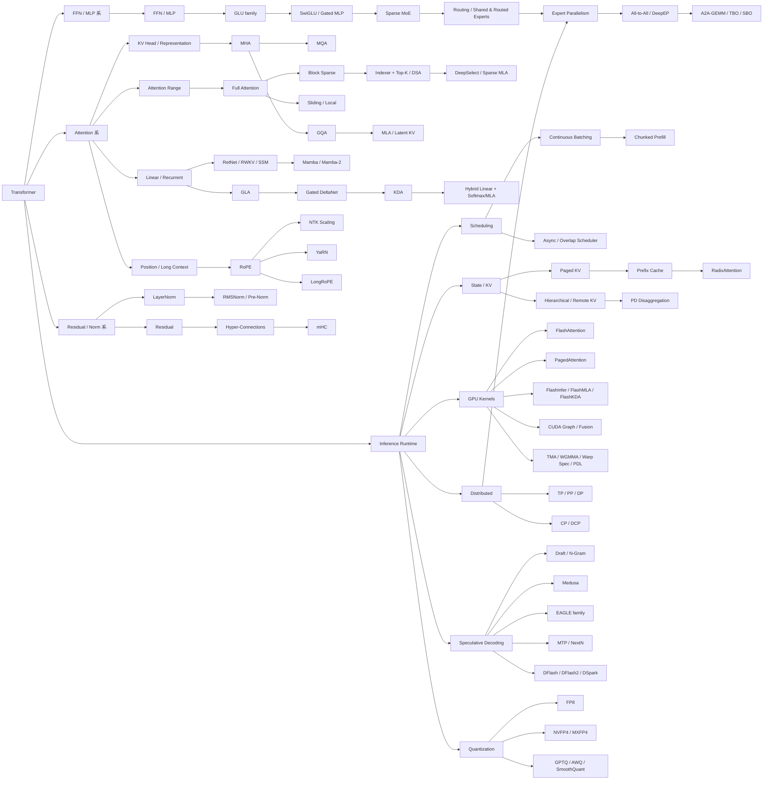

[200~# LLM 模型架构与推理优化技术全景知识图谱

## 执行摘要与研究边界

**资料截止日期：2026 年 10 月 13 日，Asia/Singapore。**  
本次调研覆盖从原始 Transformer 到 2026 年最新公开模型架构与推理系统进展，重点放在 2023–2026，尤其是 2025–2026。研究规格以你给出的完整需求为基线，并将“模型架构、算子、Kernel、Runtime、分布式、Serving、Overlap”拆成相互独立但可连接的技术链，而不是简单按模型发布时间罗列。fileciteturn0file0

证据采用五级口径：**论文 / 官方模型说明与 config / 官方引擎文档 / GitHub 源码与 Release / 官方技术博客**。其中最新功能尤其避免“文档中出现一个名词＝已经全面支持”的错误判断；引擎能力必须同时考虑模型、硬件、执行阶段和版本。vLLM 当前 release 页面已经列出到 **v0.31.0**，而 2026 年的 release 记录显示 Model Runner V2、Kimi K3、FlashKDA、DCP、DFlash2/DSpark 等仍在快速演进；SGLang 2026 年的官方仓库新闻则持续加入 Kimi K3、GLM、DFlash/Spec V2、GB300/大规模 EP 等路径。citeturn18search6turn18search0

本次调研最重要的结论不是某个单点技术，而是下面五个结构性变化。

**第一，Attention 已经不能再理解成一条 `MHA → MQA → GQA → MLA` 的单线演进。** 至少需要拆成四个正交轴：KV 表示压缩、Attention 范围稀疏化、线性/递归状态化、位置与长上下文。MHA→MQA→GQA 改的是 KV head 共享；MLA 改的是 KV 的表示空间；DSA 改的是“访问哪些历史 token”；KDA/GDN 则进一步改变了序列状态更新机制。MLA 和 DSA 因而不是替代关系，而可以直接组合。citeturn5academia1turn5academia2turn7academia12turn0search3turn9academia12

**第二，2025–2026 的核心架构趋势是 Hybridization。** Kimi Linear 用 KDA 与全局 MLA 混合；Qwen3.5 系使用 Gated DeltaNet 与全注意力混合；GLM-5.3-Flash 则更激进地把 KDA、DSA/MLA、MoE、mHC 和 MTP 放进同一 backbone。其原因很直接：递归/线性层擅长 O(1) 状态 decode 和长上下文成本控制，而少量 Softmax/稀疏注意力层保留精确内容寻址能力。citeturn9academia12turn18search1turn19search2turn19search3

**第三，MoE 把问题从“模型算多少 FLOPs”转成了“token 怎么移动”。** Switch Transformer 建立了稀疏专家范式；DeepSeekMoE 又引入细粒度专家和 shared experts，DeepSeek-V3 采用无辅助损失负载均衡。大规模推理因此自然延伸到 EP、All-to-All、专家放置/复制、DeepEP、Grouped GEMM，以及最终的 communication-compute overlap。citeturn16academia0turn16academia2turn16academia1turn7search2

**第四，推理优化的中心已经从“一个更快的 Attention kernel”上移为“整个状态与执行流水线”。** PagedAttention 解决 KV 内存分配；RadixAttention 解决跨请求前缀复用；LMCache/Mooncake 把 KV 扩展成跨 GPU、CPU、SSD、远程节点的持久状态层；PD Disaggregation 再把 Prefill 和 Decode 变成两个可独立扩缩的服务阶段。citeturn10academia2turn11academia13turn22search2turn22search8turn23search0

**第五，“Overlap”不是一个技术，而是一族发生在完全不同粒度上的调度/执行变换。** CPU-GPU overlap、Overlap Scheduler、TBO、SBO、A2A-GEMM overlap、KV-transfer overlap、CUDA stream overlap、warp specialization 和 PDL 解决的是不同依赖图。尤其 **TBO ≠ Overlap Scheduler ≠ Pipeline Parallelism ≠ CUDA Stream Overlap**。SGLang 的 TBO 是大型 MoE/EP 路径中把 batch 切成两个 micro-batch 后交错计算和通信；TensorRT-LLM 的 Overlap Scheduler 则是把前一步 CPU 处理与下一步 GPU forward 重叠。citeturn12search0turn23search4

我将知识库整理成两个层级：**核心图谱严格保留 280 个词条**，符合你要求的 200–300 条主目录；另外提供 **323 个节点的扩展版**，把性能指标、collective、底层 kernel 和生态组件也纳入。核心版全部优先 P0/P1，扩展版额外保留少量 P2/实验性概念。

## 一页全景图与技术演进链

下面这张图是整份知识库最重要的“坐标系”。箭头不统一表示“替代”：有些表示继承，有些是组合、依赖或系统后果。原始 Transformer 的基本结构来自 2017 年论文；后续 GLU/GQA/MLA、线性注意力、MoE、PagedAttention 等分别沿不同维度扩展。citeturn5academia0turn5academia3turn5academia2turn7academia12turn10academia2



**必须分开的十四条主技术链**可以压缩成下面这张索引表：

| 技术链 | 基础节点 | 主要分叉 / 新进展 | 实质上优化什么 |
|---|---|---|---|
| FFN / MLP | FFN → MLP | GLU → GEGLU/SwiGLU → Gated MLP → MoE FFN | 非线性容量、参数利用率、GEMM |
| KV Head | MHA | MQA / GQA / MLA | Decode KV 容量与带宽 |
| Sparse Attention | Full Attention | SWA / Block Sparse → Indexer + Top-K → DSA | 访问历史 token 的数量 |
| Linear / SSM | Linear Attention / SSM | RetNet / Mamba → GLA → GDN → KDA | 用固定/压缩状态替代全历史 KV |
| Hybrid Attention | 单一 Attention | KDA+MLA、GDN+Full、KDA+DSA | 在低成本状态与精确检索间折中 |
| Residual / Norm | Residual + LayerNorm | Pre-Norm/RMSNorm；Residual→HC→mHC | 深层稳定性与信息传播 |
| MoE | Dense FFN | Sparse MoE→细粒度专家→shared expert→aux-free | 参数容量 / active FLOPs |
| Position / Long Context | Absolute / Relative | RoPE→NTK/YaRN/LongRoPE | 长度外推 |
| Scheduling | Static/Dynamic Batch | Continuous→Chunked Prefill→Async/Overlap | GPU bubble、TTFT/TPOT |
| KV / Memory | KV Cache | Paged→Prefix/Radix→Hierarchical/Remote→PD | 显存、重复 Prefill、跨实例复用 |
| GPU Kernel | GEMM + naive Attention | FlashAttention、FlashMLA、FlashKDA、CuTe DSL | HBM I/O、Tensor Core 利用率 |
| Parallel / Disagg | TP/PP/DP | EP/CP/DCP→PD→异构阶段并行 | 扩展规模和阶段隔离 |
| Speculative | AR Decode | Draft→Medusa/EAGLE/MTP→DFlash/DSpark | 减少昂贵 target decode step |
| Overlap | 顺序执行 | CPU-GPU、A2A-GEMM、TBO/SBO、PDL | 把等待时间藏到有用计算下 |

其中最值得建立“二维思维”的是 Attention。**MQA/GQA/MLA 与 Sparse/Linear Attention 并不处在同一优化维度。** MQA/GQA 主要减少 K/V head 冗余；MLA 把 KV 压缩到 latent representation；DSA 只访问索引器选择出的历史位置；KDA 则维护递归状态。一个模型完全可以同时拥有“压缩表示 + 稀疏访问”，或者“线性层 + 少量全注意力层”。DeepSeek-V2 的 MLA、V3.2 的 DSA，以及 Kimi Linear 的 KDA+MLA 正好展示了这种组合趋势。citeturn7academia12turn0search3turn9academia12

**FFN 的主线也不是简单的 MLP→MoE。** Transformer FFN 本质是逐 token 的 MLP；GLU/SwiGLU 改变单个 FFN 内部的数据通路；MoE 则把整个 FFN 换成“router + 多个 FFN expert”。因此可以把现代 MoE expert 自己仍然看成一种 Gated MLP。SwiGLU 来自 GLU 变体研究，而现代大模型大量采用 gate/up/down 三投影结构。citeturn5academia3turn16academia0turn16academia2

**GLA→GDN→KDA** 是另一条非常重要的新链路。GLA 在线性注意力状态中引入 gating 并设计 chunkwise GPU 友好实现；Gated DeltaNet 将 gating 与 delta-rule 更新组合；KDA 又把门控细化并设计专门的 DPLR/chunkwise 算法。Kimi Linear 不是纯 KDA，而是以 KDA 为主、周期性插入全局 MLA，因此更准确的理解是“低成本递归记忆 + 少量精确检索层”。citeturn8academia0turn8academia2turn9academia12

**Residual→HC→mHC** 与 Attention/FFN 是独立的拓扑链。HC 把一条 residual stream 泛化为多条可学习混合的 stream；mHC 再对混合矩阵施加流形/双随机性质约束，目标首先是训练稳定性和缩放，而不是“直接减少推理 FLOPs”。因此看到 mHC 时不应把它归类成 serving optimization；它首先是模型计算图创新，之后才会给 runtime 带来额外 state layout、fusion 和 memory-access 适配问题。citeturn6academia0

## 技术名词目录与关键概念卡

核心目录分为 **20 个一级技术域、280 个核心节点**；扩展目录共 323 个节点。P0 表示推理/Infra 工程师必须掌握，P1 表示现代架构与系统应理解，P2 主要是前沿/特殊场景。这个分类是本次研究的知识组织结果，而非论文作者原有分类。

| 一级域 | 应首先掌握的名词 |
|---|---|
| Transformer 基础 | Decoder-only、Causal LM、Transformer Block、Dense/Sparse/Hybrid Transformer |
| FFN / MLP | FFN、MLP、GLU、GEGLU、SwiGLU、Gated MLP、Fused Gated MLP、MoE FFN |
| KV Head / 表示 | MHA、MQA、GQA、MLA、Latent KV、Low-rank KV、Absorbed MLA |
| Sparse Attention | Full、SWA、Local/Global、Block Sparse、Top-K Sparse、DSA、Lightning Indexer、DeepSelect |
| Linear / SSM | Linear Attention、RetNet、RWKV、Mamba、Mamba-2、GLA、GDN、KDA、GDN-2 |
| Position | RoPE、ALiBi、XPos、NTK Scaling、YaRN、LongRoPE、NoPE、Partial RoPE |
| Residual / Norm | LayerNorm、RMSNorm、Pre/Post-Norm、DeepNorm、HC、mHC、Sinkhorn-Knopp、AttnRes |
| MoE | Router、Top-K、Shared/Routed Experts、Fine-Grained Experts、Aux-Free、Replication、Placement |
| 原生加速结构 | MTP、NextN、Multi-head Token Prediction、Engram、Causal Encoder–Decoder |
| 性能基础 | Prefill、Decode、Roofline、Arithmetic Intensity、MBU、TTFT、TPOT、ITL、Goodput |
| Scheduling | Continuous Batching、Iteration Scheduling、Chunked Prefill、Async、Preemption、SLO-aware |
| GPU Kernel | FlashAttention、FlashDecoding、PagedAttention、FlashInfer、FlashMLA、Triton、CUTLASS、CuTe |
| Hardware execution | CUDA Graph、Piecewise Graph、Persistent Kernel、TMA、WGMMA、Warp Specialization、PDL |
| KV / State | Paged KV、Prefix Cache、Radix Cache、KV Quantization、Offload、Remote KV、Hybrid State |
| Quantization | FP8、FP4、NVFP4、MXFP4、INT4、GPTQ、AWQ、SmoothQuant、W4A16、KV Quant |
| Parallelism | DP、TP、PP、EP、CP、PCP、DCP、SP、Data Parallel Attention |
| Communication | All-Reduce、All-Gather、Reduce-Scatter、All-to-All、NCCL、DeepEP、MSCCL++、NVSHMEM |
| Disaggregation | PD、KV Transfer、KV-aware Routing、A-F Disaggregation、Expert Disaggregation |
| Overlap | CPU-GPU、Scheduler-Execution、A2A-GEMM、TBO、SBO、3BO、PDL、KV-transfer overlap |
| Spec / Serving | EAGLE、MTP、DFlash、DSpark、Multi-LoRA、Structured Output、Agentic Serving、RL Rollout |

下面是本次选出的 **40 个重点技术卡片**。完整字段版——包括前驱、后续、相关概念、模型、引擎、成熟度、证据类型与时间戳——已经写入交付的 Markdown/JSON/YAML；这里给出最重要的判断。

| 技术 | 核心认知 |
|---|---|
| FFN | Transformer 中逐 token 的非线性变换，本质通常就是两层/门控 MLP。 |
| SwiGLU | GLU 家族的 SiLU 门控 FFN；不要把它误认为 MoE。citeturn5academia3 |
| MHA | Q/K/V 均按多个 head 分离，质量基础好但 KV cache 最大。citeturn5academia0 |
| MQA | 所有 Q heads 共用 K/V，是降低 decode KV bandwidth 的激进方案。citeturn5academia1 |
| GQA | 若干 Q heads 共享一组 K/V，是 MHA 与 MQA 的折中。citeturn5academia2 |
| MLA | 把 KV 投影成低维 latent cache，核心优化对象是 **KV representation**。citeturn7academia12 |
| DSA | 先检索历史位置，再执行稀疏 attention，核心优化对象是 **attended token count**。citeturn0search3 |
| GLA | 在线性 Attention 状态更新中加入 gating，并设计 chunkwise 执行。citeturn8academia0 |
| GDN | Gating + delta rule，增强状态擦除与写入的选择性。citeturn8academia2 |
| KDA | GDN 后续重要分支，更细粒度门控并配套高效 chunkwise/DPLR 算法。citeturn9academia12 |
| Mamba | 选择性状态空间模型；decode 维护固定尺寸 recurrent state，而非随长度增长的传统 KV。citeturn8academia1 |
| Hybrid Attention | 线性/SSM 层降低成本，少量 Softmax/MLA 层负责精确 retrieval。citeturn9academia12turn18search1 |
| RoPE | 通过旋转 Q/K 编码相对位置，是现代 Decoder LLM 的关键位置编码族。citeturn15academia3 |
| YaRN | RoPE 长上下文扩展方法，针对频率插值和注意力尺度进行改进。citeturn15academia1 |
| RMSNorm | 比 LayerNorm 更简化的归一化形式，现代模型中广泛采用。 |
| HC | 将单 residual stream 扩展为多流混合。citeturn6academia0 |
| mHC | 给 HC 的混合施加结构约束，重点是可扩展训练的稳定性。citeturn6academia0 |
| Sparse MoE | 每 token 只激活少量专家，使总参数与 active FLOPs 解耦。citeturn16academia0 |
| Fine-Grained Experts | 把大 expert 拆成更多小 expert，增加可组合性与 specialization。citeturn16academia2 |
| Shared Experts | 把公共知识放入始终/高频激活专家，减少 routed expert 冗余。citeturn16academia2 |
| Aux-Loss-Free Routing | 不用传统负载平衡辅助梯度，而通过动态 expert bias 调节负载。citeturn16academia1 |
| MTP | 同一 hidden state 预测多个未来 token；既是模型训练结构，也可成为 speculative proposer。citeturn7academia13 |
| Prefill | Prompt 并行处理、构建 KV/state；通常比 decode 有更高算术强度。 |
| Decode | 一步生成少量 token，权重/KV 搬运往往更容易成为瓶颈。 |
| Continuous Batching | 每个 iteration 动态插入/移除请求，是现代 serving scheduler 的基础。citeturn10academia2 |
| Chunked Prefill | 长 prefill 拆块，与 decode 混排，核心是减少长 prompt 对在线 token 的干扰。citeturn2search12 |
| FlashAttention | IO-aware exact attention，关键创新是降低 HBM↔SRAM 数据搬运，而非近似 attention。citeturn10academia1 |
| FlashAttention-2 | 改进工作划分和 warp/CTA 利用率，是 FA 的 GPU execution 改良。citeturn10academia0 |
| PagedAttention | KV 内存分页和间接寻址；它与 FlashAttention 是**正交技术**。citeturn10academia2 |
| FlashInfer | Serving-oriented kernel 库，不等同于某一种 attention 算法；当前还扩展到 MoE、Blackwell 等。citeturn22search4 |
| FlashMLA | 为 MLA/稀疏 MLA 服务的高性能 kernel 路线。citeturn0search3 |
| RadixAttention | 把 KV prefix reuse 与 radix-tree 缓存管理、调度结合。citeturn11academia13 |
| Hierarchical KV | KV 从 GPU 扩展到 CPU/SSD/remote tier，状态管理从 allocator 上升为 storage system。citeturn22search2 |
| PD Disaggregation | Prefill 与 Decode 独立资源池，KV 是阶段间 handoff 数据。citeturn23search0turn22search8 |
| EP | MoE 专家分布到不同 GPU，代价是 token dispatch/combine 的 A2A。citeturn7search2 |
| DeepEP | 专门优化 MoE dispatch/combine 的通信库，是模型→系统协同的典型代表。citeturn7search2 |
| TBO | 两个 micro-batch 交错 attention/compute 与 MoE communication，核心是 hide A2A。citeturn12search0 |
| SBO | 同一 batch 内寻找可并行计算与通信，比 TBO 更适合 micro-batch 不够大的情况。citeturn12search0 |
| Overlap Scheduler | CPU 处理 step N 时 GPU 已执行 step N+1；本质是 host/device pipeline。citeturn23search4 |
| EAGLE-3 | speculative drafter 使用直接 token 预测和多层 feature fusion，是 EAGLE 系的重要升级。citeturn21academia48 |
| DFlash / DSpark | 2026 年新一代并行 draft 路线，已经进入 vLLM/SGLang 的快速工程迭代阶段。citeturn18search6turn14search13 |
| FP8 / FP4 | 量化已经从“压缩 checkpoint”发展成与 Tensor Core、KV cache、MoE kernel 深度绑定的执行格式。citeturn23search2 |

其中几个最容易混淆的概念，可以用下面这组判断快速定位：

**MLP vs FFN vs Gated MLP：** MLP 是通用网络结构名；Transformer FFN 是 MLP 在 block 中的角色；Gated MLP 是 FFN 的一种具体实现。MoE FFN 则是在“整个 FFN 模块”外再加 router 和多个 expert。

**MHA vs MQA vs GQA vs MLA：** 前三者主要在“KV heads 数量”上变化；MLA 则把 KV 的表示本身压成低维 latent，因此不是“GQA 再少几个 KV head”那么简单。citeturn5academia1turn5academia2turn7academia12

**MLA vs DSA：** MLA 回答“每个历史 token 存什么”；DSA 回答“当前 query 看哪些历史 token”。二者可以叠加。DeepSeek-V3.2 正是这条路线。citeturn0search3

**Sparse Attention vs Linear Attention：** 前者仍然选择历史 token 并做显式 query-key interaction，只是集合变小；后者则重写计算，使历史被聚合到 state 中。因此一个长上下文 sparse attention 仍有 token-indexing/KV storage 问题，而 recurrent linear attention 的 decode state 可以固定大小。citeturn8academia0turn8academia2

**Mamba vs Linear Attention：** 两者都能形成 recurrent decode，但数学参数化和状态更新机制不同；近年来 state-space duality 又进一步拉近了两类模型的实现视角，因此工程上更重要的是看“state layout、prefill scan/chunk algorithm、decode update kernel”，而不是只看论文分类名。citeturn8academia1

**MTP vs Speculative Decoding：** MTP 是模型结构/训练目标；Speculative Decoding 是推理算法。MTP head 可以作为 speculative proposer，但 MTP 本身并不等价于整套 draft–verify 协议。DeepSeek-V3 同时体现了模型侧 MTP，而 vLLM/TensorRT-LLM 则把 MTP 作为 speculative 方法之一。citeturn7academia13turn2search5turn23search8

**FlashAttention vs PagedAttention：** 一个优化 attention kernel 的 I/O；一个解决动态 KV 内存管理与寻址。现代 engine 通常同时需要两者。citeturn10academia1turn10academia2

## 现代模型架构矩阵

现代模型已经明显从“同一 Transformer 模板只是 scale 不同”进入“架构决定 serving runtime”的阶段。DeepSeek-V2 的 MLA 直接要求 latent-KV backend；V3 的 MoE+MTP 要求 EP 与 speculative 适配；V3.2 再加入 DSA。GLM-5.3-Flash 更进一步，把 KDA recurrent state、KPool-DSA sparse KV、MoE、mHC、MTP 和视觉编码放进一个模型，这使 runtime 必须同时管理多种 state 类型。citeturn7academia12turn7academia13turn0search3turn19search3

| 模型族 | Attention 主线 | FFN / MoE | Residual / Norm | 原生加速结构 | 对推理系统的主要挑战 |
|---|---|---|---|---|---|
| 原始 Transformer | MHA | ReLU FFN | Residual + Post-LN | 无 | 标准 KV + Dense GEMM。citeturn5academia0 |
| Llama 3 | Dense decoder Transformer；现代 GQA/RoPE 路线 | Dense | RMSNorm/SwiGLU 系 | 无原生 MTP 主线 | 是现代 dense serving 的重要基线；Llama 3 technical report 披露 405B dense、128K context。citeturn26academia0 |
| Mixtral 8×7B | Mistral attention backbone | 每层 8 FFN experts，Top-2 | Mistral backbone | 无 | Expert routing、Grouped GEMM、EP；论文给出约 47B 参数、约 13B active。citeturn26academia1 |
| DeepSeek-V2 | **MLA** | DeepSeekMoE | modern Pre-Norm | — | latent KV、MLA kernel、MoE EP；官方报告称 KV cache 相对 DeepSeek-67B 大幅降低。citeturn7academia12 |
| DeepSeek-V3 | MLA | DeepSeekMoE；aux-loss-free balance | modern Norm | **MTP** | MLA + large EP + FP8/MTP 的模型系统协同。citeturn7academia13 |
| DeepSeek-V3.2 | **DSA + MLA** | MoE | 延续 V3 系 | MTP 系 | 需要 indexer、Top-K 和 sparse MLA kernel。citeturn0search3turn0search9 |
| DeepSeek-V4 / V4.1 Flash | 官方 V4.1 Flash 公开了新的 Causal Encoder–Decoder 路线 | MoE | 新拓扑 | 新模型专用 | 官方说明称进一步压低 KV/HBM/SSD 状态开销；应按 checkpoint/runtime 实现核验，不能简单等同于 V3。citeturn4search2 |
| Qwen3-Next / Qwen3.5 | **Gated DeltaNet + Full Attention Hybrid** | Qwen3.5 同时采用 sparse MoE 系 | RMSNorm 系 | 型号相关 | runtime 同时维护 recurrent state 与标准 KV。Qwen3.5 官方材料把高效 hybrid architecture 作为关键变化。citeturn18search1turn3search7 |
| Qwen3.8 | Qwen 最新公开系列延续 Qwen3.x 高效模型路线；具体层布局应以具体 checkpoint config 为准 | 既有 dense，也有超大 MoE 型号 | checkpoint-specific | checkpoint-specific | 2026 年 8 月 Qwen3.8 系列已公开，因此知识库不应停留在“Qwen3.5 是最新”。citeturn18search1 |
| Kimi Linear | **3:1 KDA : MLA hybrid** | 模型配置相关 | modern Norm | — | KDA chunkwise prefill + recurrent decode state + MLA KV 的混合管理。citeturn9academia12turn0search17 |
| Kimi K3 | KDA 主线 + Attention Residuals | 超大 MoE / Stable LatentMoE | AttnRes | serving 可叠加 spec | 1M 级长上下文、KDA、超大 expert count、EP/quantization 共同塑造 runtime。citeturn3search9 |
| GLM-5.2 | Sparse Attention/MLA 路线 + **IndexShare** | 大型 MoE | modern Norm | 改进 MTP | 官方称 IndexShare 在多个 sparse layers 间共享 indexer，针对 1M context 降低索引成本。citeturn19search2 |
| GLM-5.3-Flash | **34 KDA + 11 KPool-DSA** | 前 3 dense，后续 MoE；288 routed、Top-8 + shared expert | **4-stream mHC** | **原生 MTP draft** | 当前最典型的 hybrid-state serving 压力测试之一；NVIDIA native implementation 明确给出上述层结构。citeturn19search3turn19search12 |
| Gemma 3 | 5 local : 1 global attention；GQA | Dense 系 | Pre/Post RMSNorm | — | Sliding local KV + global KV 混合；Google 官方说明这一改变主要面向 KV-memory efficiency。citeturn24search12 |
| gpt-oss | alternating dense / locally banded sparse attention；grouped multi-query attention | MoE | Transformer 系 | — | gpt-oss-120b 总参数约 117B、每 token 激活约 5.1B；原生 128K，权重发布采用 MXFP4 路线。citeturn24search0turn24search7 |

这里尤其值得关注 **GLM-5.3-Flash**，因为它把用户最初关注的几条链真正交汇到了一起。Z.ai 官方说明只需要到“hybrid sparse + linear attention + mHC”这一层就已经足够确认模型方向；NVIDIA 的 native model implementation 进一步给出了 **45 层 decoder 中 34 层 KDA、11 层 KPool-DSA，4-stream mHC，288 routed experts、Top-8、1 shared expert** 的具体结构。这意味着“GLM 的 KDA”不只是论文概念，它已经成为生产 runtime 必须适配的真实 state operator。citeturn19search2turn19search3

同样，**Qwen3.5 之后也不能再把 Qwen 视作普通 GQA Transformer。** 官方 Qwen 材料将 Gated Delta Networks + sparse MoE 明确列为 Qwen3.5 的效率架构创新；Hugging Face 的模型文档进一步描述了约 3:1 的 Gated DeltaNet/full-attention hybrid pattern。因此对这类模型，传统“每层都有标准 KV cache”的 CacheManager 抽象已经不再充分。citeturn18search1turn3search7

这也是 2026 年推理引擎的重要架构变化：cache manager 正在逐渐演化成更泛化的 **model state manager**——同一个模型可能同时存在 full-attention KV、sliding KV、latent KV、KDA/Mamba recurrent state、稀疏 index metadata 和 speculative state。vLLM 近期 release 中针对 Kimi K3 的 DCP、fused FlashKDA prefill/decode、speculative token budget 等优化就是这种转变的直接工程表现。citeturn18search6

## 推理优化、Overlap 与引擎支持

推理优化最好不要按“某引擎有哪些 feature”背诵，而应按 **critical path** 理解：

```text
Request
  ↓
Tokenizer / multimodal encoder
  ↓
Global routing / cache lookup
  ↓
Scheduler
  ↓
Batch formation / chunked prefill
  ↓
Model Runner
  ↓
Attention + FFN/MoE
  ↓
Collectives / KV transfer
  ↓
Sampling / structured decoding
  ↓
CPU postprocess
  ↓
Next iteration
```

几乎所有优化都在做四件事之一：**少算、少搬、并行算、把等待藏起来。**

FlashAttention 属于“少搬”；quantization 同时“少搬+更高低精度算力”；speculative decoding 属于“减少 target 串行 step”；continuous batching 属于“把 GPU 填满”；PD 属于“把资源冲突拆开”；Overlap 则是在原本仍然存在的等待上寻找并行工作。citeturn10academia1turn20academia48turn20academia50turn23search0

**KV 侧已经形成一条非常清晰的系统演进：**

```text
Contiguous KV
   ↓
Paged KV / PagedAttention
   ↓
Prefix Cache
   ↓
RadixAttention / Prefix-aware scheduling
   ↓
GPU → CPU → SSD / Remote hierarchical cache
   ↓
Cross-worker KV sharing
   ↓
PD Disaggregation
   ↓
KV-aware global routing / elastic serving
```

vLLM 的 PagedAttention 解决了 KV allocation/fragmentation；SGLang 的 RadixAttention 把 prefix sharing 加进调度器；LMCache 把 KV 做成独立、持久、分层的 cache layer；Mooncake 进一步围绕 KVCache-centric disaggregation 构建 transfer/storage/scheduler。citeturn10academia2turn11academia13turn22search2turn22search8

**量化侧则需要同时看“数值算法”和“硬件格式”。** GPTQ 是利用二阶信息做低 bit weight PTQ；AWQ 用 activation statistics 保护重要权重通道；SmoothQuant 把 activation outlier 的量化难度迁移到权重，实现 W8A8。进入 Hopper/Blackwell 以后，FP8、NVFP4、MXFP4、FP8/NVFP4 KV cache 则越来越是“硬件执行格式”而不仅仅是模型压缩方法。TensorRT-LLM 当前官方文档同时列出 FP4、FP8 per-tensor/block/rowwise、FP8/NVFP4 KV、AWQ/GPTQ W4A8/W4A16 等路径。citeturn20academia48turn20academia49turn20academia50turn23search2

**Speculative Decoding 的发展主线**可以记成：

```text
small draft model
   ├── N-Gram / suffix matching
   ├── self-speculation
   ├── Medusa multi-head + tree
   ├── EAGLE feature draft
   │      └── EAGLE-2
   │             └── EAGLE-3 direct-token + multi-layer features
   ├── native MTP / NextN
   └── parallel/block draft
          ├── DFlash
          ├── DFlash2
          └── DSpark
```

Medusa 用多个 decoding heads 一次提出未来 token 并通过 tree attention 验证；EAGLE 在 feature 层做 proposer；EAGLE-3 改成直接 token prediction 与多层 feature fusion。2026 年引擎工程进一步向 DFlash/DFlash2/DSpark、自适应 draft budget 和在线训练 proposer 发展。citeturn21academia49turn21academia50turn21academia48turn18search6

**Overlap 分类树：**

```mermaid
flowchart TD
    O["Overlap"]
    O --> HOST["Host / Device"]
    HOST --> CGPU["CPU–GPU"]
    HOST --> SCHED["Scheduling–Execution"]
    HOST --> COPY["H2D / D2H–Compute"]

    O --> DIST["Distributed Communication"]
    DIST --> CC["Compute–Communication"]
    DIST --> C2["Communication–Communication"]
    DIST --> A2A["All-to-All–GEMM"]
    DIST --> KVX["KV Transfer–Compute"]

    O --> BATCH["Batch / Pipeline"]
    BATCH --> TBO["TBO / 2BO"]
    BATCH --> BO3["3BO / XBO"]
    BATCH --> SBO["SBO"]
    BATCH --> PP["Micro-batch / Layer pipeline"]

    O --> KERN["Kernel"]
    KERN --> STREAM["CUDA stream"]
    KERN --> WARP["Warp specialization"]
    KERN --> PDL["Programmatic Dependent Launch"]
    KERN --> PC["Producer–Consumer"]

    O --> SERVICE["Service stages"]
    SERVICE --> PD["Prefill–Decode"]
    SERVICE --> SPEC["Draft–Verify pipeline"]
```



下面按你要求的“八问”把主要 Overlap 类型压进一个矩阵：

| 技术 | 交叠什么 | 粒度 | 原本依赖 | 如何解除/隐藏 | 是否要多请求 | 条件 | 目标 | 代表实现 |
|---|---|---|---|---|---|---|---|---|
| CPU-GPU / Overlap Scheduler | step N CPU 后处理 ↔ step N+1 GPU | iteration | 有跨 step 状态依赖 | async sampling、延迟消费结果、流水化 | **不必** | 连续 decode step 即可 | GPU idle、吞吐 | SGLang；TRT-LLM。citeturn23search4 |
| H2D/D2H-Compute | copy ↔ kernel | buffer/stream | 当前块有依赖 | 双缓冲 + async copy/event | 不必 | pinned memory/copy engine | Latency/throughput | CUDA 通用 |
| A2A-GEMM | MoE token 通信 ↔ expert GEMM | token chunk/kernel | 同 token 有依赖 | 分块，已到达 token 先算 | 不必多请求 | **EP + 足够 token** | 隐藏通信 | DeepEP/定制 MoE kernel。citeturn7search2 |
| TBO | micro-batch A 通信 ↔ micro-batch B 计算 | micro-batch/layer | 同 micro-batch 串行 | 跨 micro-batch 交错 | 不要求两个“用户请求”，但要有两个可执行 micro-batch | 大 batch、MoE、EP | 主要吞吐 | SGLang EP。citeturn12search0 |
| SBO | 一个 batch 内局部计算 ↔ 通信 | intra-batch | 部分可拆 | dispatcher hook、stream、工作切分 | **单 batch 可** | 有可独立工作 | 吞吐/延迟 | SGLang 部分 EP 路径。citeturn12search0 |
| KV Transfer-Compute | 请求 A KV 传输 ↔ 请求 B compute | request/service | **同请求 transfer→decode 仍有依赖** | 跨请求隐藏 | 通常需要其它 ready work | PD + 高并发 + 快速互联 | TTFT/TPOT/吞吐 | TRT-LLM、PD 生态。citeturn23search0 |
| PDL | 前驱 kernel 尾部 ↔ 后继 kernel 头部 | kernel | kernel dependency | GPU-side dependent launch | 不必 | 特定 CUDA/GPU kernel | launch gap | DSA 等新 kernel path |
| Warp producer-consumer | memory load ↔ MMA | kernel/warpgroup | tile 级依赖 | TMA + barrier + multistage | 不必 | Hopper/Blackwell 尤其有效 | kernel throughput | CUTLASS/CuTe/FlashAttention 系 |

**TBO 是最值得单独纠正认知的技术。** SGLang 的 EP 文档把 TBO 描述为把 request batch 分成两个 micro-batch，再将一个 micro-batch 的 attention/compute 与另一个的 MoE dispatch/combine 交叠；因此“Two-Batch”不是“必须有两个独立用户请求”。citeturn12search0turn12search12

但这不意味着 **单请求、小 batch 都能获益**。当前公开工程经验明确显示：TBO 在大 batch 上更容易获得吞吐收益，而小 batch、单请求或非常小的 decode batch 会因为 micro-batch 变得太小，额外 launch、同步、拆分开销抵消 overlap；H20 的 SGLang 实践也观察到 decode TBO 的正向收益更偏向较大的 batch。citeturn12search8turn12search17

所以对你特别问到的三个 case，应当这样判断：

**单请求 Prefill：** 不应仅凭“TBO 可拆 batch”就认为一定有效。若当前 runner 是按 request/batch 维切 micro-batch，batch=1 就没有两个非空工作单元；如果某模型专用实现能沿 prefill token/chunk 维重新切分，则理论上可以形成 overlap。当前 SGLang 的 TBO 还有模型/阶段专用 gate，因此要检查具体 model runner，而不能做通用结论。citeturn12search13

**单 token Decode / batch=1：** 几乎没有足够的第二个 micro-batch 工作来遮蔽 A2A；这时更值得看 SBO、kernel-level producer-consumer、CPU-GPU overlap、PDL 和 speculative decoding。

**小 batch Decode：** 是否有效取决于 `communication_saved > split + launch + synchronization + smaller-GEMM efficiency loss`。所以 TBO 不是“通信存在就应该开启”的 feature，而是具有明显 crossover point 的 workload optimization。SGLang 自己的公开实践也显示小 batch 可出现负收益。citeturn12search8turn12search17

另外，**3BO 暂时不应该标成 SGLang 的成熟标准能力**。2026 年 SGLang 官方 issue 中，多 batch/XBO 和 3BO 仍曾以 feature request/RFC 类路径讨论，因此知识库中将其标为“实验/研究前沿”比标“稳定支持”更准确。citeturn13search4

**引擎支持矩阵：**

| 技术 | vLLM | SGLang | TensorRT-LLM | 关键区别 |
|---|---|---|---|---|
| Continuous Batching | ✅ 核心 | ✅ 核心 | ✅ In-flight batching | 三者均成熟 |
| Paged KV / Attention | ✅ PagedAttention 起家 | ✅ paged runtime | ✅ paged KV | 内部 allocator/runner 不同 |
| Prefix Cache | ✅ | ✅ **RadixAttention** | ✅ | SGLang 的 radix tree 是标志性设计。citeturn11academia13 |
| Chunked Prefill | ✅ | ✅ | ✅ 类似能力 | scheduling policy 差异很重要 |
| MLA | ✅ 专门 backend | ✅ DeepSeek 优化成熟 | ✅ 模型相关 | FlashMLA/FlashInfer 等 backend 可交叉复用 |
| DSA / Sparse MLA | ✅ 2026 持续优化 | ✅ DeepSeek/GLM 专用路径 | 模型相关 | 不能写成“所有模型稳定支持”。citeturn18search6turn19search12 |
| KDA | ✅ Kimi/GLM，FlashKDA 等 | ✅ Kimi/GLM | 模型相关 | 需要 recurrent state manager |
| Hybrid State | ✅ Mamba/KDA/Attention 混合支持不断扩大 | ✅ | 模型相关 | 是 2026 runtime 重点 |
| CUDA Graph | ✅ full/piecewise 等 | ✅ | ✅ | 动态 MoE/spec/hybrid state 会形成 graph break |
| Overlap Scheduler | async/model-runner 路线 | ✅ 标志性能力 | ✅ 默认启用 | TBO 与它无关。citeturn23search4 |
| TBO | 非通用同名能力 | ✅ **MoE/EP 专用** | 无同名公共机制 | 模型、batch、阶段敏感 |
| SBO | 无统一同名接口 | ⚠️ 部分路径 | 无同名公开 API | 前沿/模型相关 |
| TP | ✅ | ✅ | ✅ | 成熟 |
| PP | ✅ | ✅ | ✅ | 成熟 |
| EP | ✅ | ✅ 强调 large-scale EP | ✅ | 通信 backend 各异 |
| CP / DCP | ✅，Kimi K3 等持续优化 | ✅ 模型相关 | 支持长上下文并行路径 | DCP 不等于 Prefill CP。citeturn18search6turn2search7 |
| DeepEP | ⚠️ 版本/模型相关 | ✅ 重要 backend | 非主路线 | DeepSeek/SGLang 生态最深。citeturn7search2 |
| PD Disaggregation | ✅ KV Connector 路线 | ✅ | ✅ NIXL/UCX 等 | **PD 本身不保证吞吐提升**；价值主要是资源/SLO 解耦。citeturn2search1turn23search0 |
| LMCache | ✅ 深度集成 | ✅ KV offload 集成 | 生态集成 | 独立 cache layer。citeturn22search2 |
| Mooncake | ✅ KV connector/生态 | ✅ Transfer Engine/Store | Transfer Engine 集成 | KV-centric disaggregation。citeturn22search8 |
| N-Gram/Suffix Spec | ✅ | ✅ 类似路径 | N-Gram | 几乎零 draft-model storage |
| EAGLE | ✅ | ✅ | ✅ | production spec 主线之一 |
| MTP Spec | ✅ | ✅ | ✅ | DeepSeek/GLM 原生结构特别适合 |
| DFlash/DFlash2/DSpark | ✅ 2026 主线 | ✅ DFlash/Spec V2；组合支持需逐版本核验 | 尚非主线 | 最新快速演进区。citeturn18search6turn18search0 |
| FP8 | ✅ | ✅ backend-dependent | ✅ Hopper+ 重点 | 主流 |
| NVFP4/MXFP4 | ✅ Blackwell 路线 | ✅ Blackwell 路线 | ✅ 强项 | 与 GPU 代际强绑定。citeturn23search2 |
| Structured Output | ✅ | ✅ SGLang 强项 | ✅ | grammar/FSM backend 不同 |
| Multi-LoRA | ✅ | ✅ | ✅ | 调度、adapter cache 与 kernel 路径不同 |

vLLM 与 SGLang 当前真正值得源码阅读的差别，不只是“谁快”。vLLM 的核心思想从 PagedAttention 逐步扩展成通用 scheduler/model-runner/backend 架构，并在 2026 年持续推进 Model Runner V2、hybrid model、DCP、speculation 和新 CUDA graph 路径；SGLang 则从 RadixAttention 起就更强调**prefix-aware runtime**，随后把 zero-overhead scheduler、large-scale EP、PD、TBO/SBO 与新模型 day-0 support 纳入同一执行体系。citeturn10academia2turn18search6turn11academia13turn18search0

TensorRT-LLM 则体现另一种路线：更深绑定 NVIDIA hardware/software stack。其最新文档明确把 overlap scheduler、disaggregated KV transmission、NIXL/RDMA/NVLink、FP8/FP4/KV quantization 等做成第一方机制；其中 KV transmission 甚至明确支持把某请求的 KV send/receive 与其他请求的模型计算重叠。citeturn23search0turn23search2turn23search4

## 学习路线、证据口径与可维护交付物

以你已经熟悉 Transformer、GPU/CUDA、vLLM/SGLang 的背景，**最不值得做的事情是重新从 Attention 公式开始学两周**。最高效的 catch-up 路线应该沿着“现代模型为什么迫使 runtime 改变”来学。

**一小时速览**

先把下面十组关系记住即可：

```text
FFN → GLU → SwiGLU → MoE
MHA → MQA/GQA → MLA
Full → Sparse → Indexer/DSA
Linear → GLA → GDN → KDA
Residual → HC → mHC
KV → Paged KV → Prefix/Radix → Hierarchical → PD
Batching → Continuous → Chunked Prefill → Async/Overlap
TP → EP/CP/DCP
Draft → EAGLE/MTP/DFlash
CPU-GPU overlap ≠ TBO ≠ CUDA-stream overlap
```

读完以后，应能够对一个新名词先问：**它改变模型计算图、模型状态、kernel、调度、通信还是服务拓扑？**

**一天 Catch-up**

上午用 DeepSeek-V2/V3/V3.2 串起 **MLA→MoE→MTP→DSA**；再用 Kimi Linear 串起 **GLA→GDN→KDA→Hybrid Attention**；最后读 mHC。DeepSeek-V2/V3 和 Kimi Linear 的原论文已经足以建立这三条核心架构链。citeturn7academia12turn7academia13turn9academia12turn6academia0

下午用 GLM-5.3-Flash 把几条链“合并回一个真实模型”：KDA recurrent state、KPool-DSA sparse attention、mHC、MoE、MTP。然后打开 vLLM/SGLang 对这个模型的 runner/backend，看它们如何决定 attention backend、state allocation、CUDA graph、EP 和 speculation。citeturn19search3turn19search12

晚上专攻 serving：PagedAttention→RadixAttention→LMCache/Mooncake→PD，再看 Overlap Scheduler→TBO/SBO→A2A-GEMM overlap。这样一天之后，你看到“KV connector”“DeepEP”“TBO”“hybrid state manager”“DCP”就已经能放回完整系统，而不会把它们看成散乱 feature。citeturn10academia2turn11academia13turn22search2turn22search8turn12search0

**两周系统路线**

第一阶段读模型计算图：Transformer/GLU/GQA → MLA/DSA → GLA/GDN/KDA → MoE → HC/mHC。重点不是推公式，而是给每个模块写出 `input tensor → state → GEMM/scan/top-k → communication → output tensor`。

第二阶段读推理热路径：从 scheduler 开始，一路 trace 到 model runner、attention backend、MoE backend、cache manager、collectives 和 sampling。对 vLLM 和 SGLang 用同一个请求跟踪一次完整 Prefill 与 Decode，观察 Python/CPU、CUDA graph、KV allocation 和 kernel sequence 的不同。vLLM 当前主线已经把 Model Runner V2 作为重要执行层方向；SGLang 则持续把 zero-overhead scheduler 与模型专用 backend 深度结合。citeturn18search6turn18search0

第三阶段专攻分布式：TP collective→EP All-to-All→DeepEP→expert placement/replication→TBO/SBO；然后再学 CP/DCP 与 PD。这一步会让你真正理解为什么“模型 FLOPs 更少”不代表 serving 更快。

第四阶段做一套固定 benchmark：至少记录 `input length / output length / batch / concurrency / TTFT / TPOT / throughput / goodput / HBM / KV usage / NCCL-A2A time / GEMM utilization / graph capture status`。所有论文或博客中的“2×、5×、10×”如果没有这些上下文，都不应该进入长期知识库的“性能结论”字段。

本知识库对成熟度采用：

| 标签 | 定义 |
|---|---|
| **基础** | 已成为领域基础概念，几乎不再存在支持与否问题 |
| **主流** | 多模型、多引擎生产使用 |
| **前沿** | 已有正式模型/代码/引擎实现，但支持边界仍明显 |
| **实验** | 论文、原型、RFC、特定模型路径或未完全合并 |
| **逐渐淘汰** | 仍需认识，但现代设计已较少作为首选 |

引擎 feature 的证据则区分 **论文提出 → 代码实现 → PR merge → release → stable docs**。例如 3BO 不能仅因为公开 issue 出现就写成“支持”；同理，某引擎支持 KDA 模型也不意味着任意 KDA 架构、任意量化、任意 CUDA graph、任意 CP 组合都工作。citeturn13search4turn18search6

最终交付物已经生成：

**完整包：** [下载全部知识库文件](sandbox:/mnt/data/llm_arch_inference_knowledge_graph_2026-10-13.zip)

**主 Markdown 知识库：** [knowledge_base.md](sandbox:/mnt/data/llm_knowledge_graph_2026-10-13/knowledge_base.md)  
包含 323 条扩展目录、一页 Mermaid、主要演进链、40 项重点技术卡、Overlap 专题、模型矩阵、引擎矩阵与学习路线。

**严格 280 条核心目录：** [terms_core_280.csv](sandbox:/mnt/data/llm_knowledge_graph_2026-10-13/terms_core_280.csv)

**核心机器可读图谱：** [knowledge_graph_core_280.json](sandbox:/mnt/data/llm_knowledge_graph_2026-10-13/knowledge_graph_core_280.json) · [knowledge_graph_core_280.yaml](sandbox:/mnt/data/llm_knowledge_graph_2026-10-13/knowledge_graph_core_280.yaml)

**323 节点扩展图谱：** [knowledge_graph.json](sandbox:/mnt/data/llm_knowledge_graph_2026-10-13/knowledge_graph.json) · [knowledge_graph.yaml](sandbox:/mnt/data/llm_knowledge_graph_2026-10-13/knowledge_graph.yaml) · [terms.csv](sandbox:/mnt/data/llm_knowledge_graph_2026-10-13/terms.csv)

**模型矩阵：** [model_matrix.csv](sandbox:/mnt/data/llm_knowledge_graph_2026-10-13/model_matrix.csv)

**推理引擎支持矩阵：** [engine_matrix.csv](sandbox:/mnt/data/llm_knowledge_graph_2026-10-13/engine_matrix.csv)

**Overlap 八问矩阵：** [overlap_matrix.csv](sandbox:/mnt/data/llm_knowledge_graph_2026-10-13/overlap_matrix.csv)

机器可读节点采用 `id / name / name_zh / category / first_seen / summary / core_problem / principle / predecessors / successors / related / models / engines / performance_impact / maturity / priority / evidence_type / source / source_date / verified_at` 字段；关系边明确区分 `evolves-to / variant / sparse-alternative / combined-with / depends-on / optimized-by / implementation-pattern` 等关系。这样以后出现 DeepSeek 新架构、Qwen 新 hybrid layer、SGLang 新 overlap、vLLM 新 model runner 时，只需增节点和边，而不需要重写整份目录。
