# LLM 模型架构与推理优化技术全景知识图谱：第一版

## 执行摘要与研究边界

**资料截止日期：2026 年 10 月 13 日（Asia/Singapore）**。本版以你给出的研究纲要与验收口径为范围基线，重点不是“逐篇论文综述”，而是建立一个适合 LLM 推理工程师长期维护的**概念—演进—模型—Kernel—引擎—Serving**知识图谱。fileciteturn0file0

截至本次检索，推理工程领域已经不能再用“Transformer + FlashAttention + PagedAttention + Continuous Batching”这套 2023 年左右的框架完整理解。更合适的视角是把系统拆成六层：

> **模型数学结构 → 状态/KV 表示 → GPU 算子 → 分布式通信 → Runtime/Scheduler → Serving 拓扑**

2017 年 Transformer 奠定了 Attention + FFN + Residual/Norm 的基本计算图；之后的主线并不是一个单一路径，而是多个相互耦合的优化方向。原始 Transformer 的 MHA、两层 FFN 和标准 residual 仍是概念坐标原点。citeturn0academia0turn0academia3

过去几年最重要的结构趋势可以压缩成以下几句话：

**第一，Attention 的核心问题已经从“怎样计算 Softmax Attention”转向“应该保存什么状态、访问哪些历史、怎样让状态适合硬件”。** MQA/GQA 减少 KV heads；MLA 改变 KV 表示；DSA/CSA/KPool-DSA 改变“访问哪些历史”；Gated DeltaNet/KDA 则进一步把历史从 token-wise KV cache 转化为 recurrent state。citeturn11academia25turn11academia24turn0academia2turn1search0turn7academia1turn27view3

**第二，Hybrid Attention 已经成为 2025–2026 年最值得关注的路线之一。** Qwen3.5-9B 的公开配置是每四层中三层 Gated DeltaNet、一层 Gated Attention；GLM-5.3-Flash 是 45 层中 34 层 KDA、11 层 KPool-DSA；DeepSeek-V4 则将 sliding/local branch、Compressed Sparse Attention 与 Heavily Compressed Attention 组合起来。这不是偶然：局部/线性状态适合低成本维护历史，而周期性的全局或稀疏 Softmax Attention 用来恢复内容寻址能力。citeturn28view2turn28view0turn27view0

**第三，Residual 本身也重新成为架构创新对象。** Hyper-Connections 将单一 residual stream 扩展成多个动态混合 residual streams；mHC 再通过流形约束限制混合矩阵，以改善深层信号传播稳定性。DeepSeek-V4 已把传统 residual 替换成多流 mHC；GLM-5.3-Flash 同样采用四个持续 residual streams。citeturn8academia25turn6academia0turn27view0turn28view0

**第四，MoE 的工程问题已经从“Top-K router”升级成“模型结构 + expert placement + All-to-All + kernel + overlap”的联合设计问题。** DeepSeekMoE 的 fine-grained experts 与 shared experts 是结构层创新；DeepEP 则把 dispatch/combine、低延迟通信以及 communication-compute overlap 做成专门通信栈。citeturn21academia0turn22search0

**第五，推理系统的优化中心正在从单 kernel 优化走向 pipeline/overlap。** FlashAttention 通过 IO-aware tiling 减少 HBM traffic；PagedAttention 解决动态 KV 内存；Continuous Batching 解决请求粒度调度；而 2025–2026 年的 TBO/SBO、async scheduler、piecewise/breakable CUDA Graph、EP overlap、PD disaggregation 则在解决“不同工作为什么不能同时运行”。citeturn10academia0turn12academia0turn23search10turn25view3turn25view2

**第六，Speculative Decoding 已经从经典 draft-target 变成一个完整技术树。** Classical speculation、Medusa、EAGLE、MTP、DFlash、DSpark 等方法优化的对象不同：有的改善 proposal model，有的改变 proposal topology，有的改变 verification，有的直接把 draft capability 训练进模型。citeturn12academia3turn13academia14turn13academia12turn24view0

从引擎角度，截至本次截止日期，vLLM 最新公开 release 为 **v0.31.0，2026-10-05**；SGLang 最新公开 release 为 **v0.5.21，2026-10-02**；TensorRT-LLM release notes 已到 **1.3，2026-09**。值得注意的是，这几个系统已经在竞争 DeepSeek-V4.1、GLM-5.3-Flash、Kimi K3、KDA/GDN、稀疏 MLA、MTP/DSpark、PD、EP overlap 等非常新的 workload，而不再只是在传统 Llama 上竞争 attention throughput。citeturn24view0turn25view0turn26view0

### 一个最重要的认知框架

对于以后遇到的任何新名词，先问它改变的是哪一层：

| 层次 | 核心问题 | 典型名词 |
|---|---|---|
| 模型结构 | 模型本身算什么 | GQA、MLA、KDA、mHC、MoE、MTP |
| 状态表示 | 历史信息存什么 | KV Cache、Latent KV、Recurrent State、Compressed KV |
| Algorithm/Kernel | 同样数学如何更快算 | FlashAttention、FlashMLA、FlashKDA、Grouped GEMM |
| 分布式 | 多 GPU 间数据怎么走 | TP、EP、CP、DCP、DeepEP、All-to-All |
| Runtime | 工作何时执行 | Continuous Batching、Chunked Prefill、Async Scheduling、TBO |
| Serving | 工作放在哪些机器上 | PD Disaggregation、KV Routing、Elastic EP、Hierarchical Cache |

这六层**一定不要混在一起比较**。FlashAttention 和 PagedAttention 不是竞争算法；MLA 和 DSA 不是同一优化维度；TBO 和异步调度不是同一种 overlap；MTP 也不等于 speculative decoding。

## 顶层技术地图与主要演进路线

### 一页式技术全景图

下面的顶层图将“模型结构”和“系统执行”故意分开，再在 KV、MoE、Speculation 和 Hybrid State 处连接起来。这比按照模型发布日期排列更适合推理工程师。其基础节点来自 Transformer、FlashAttention、PagedAttention、SGLang/RadixAttention，以及 2024–2026 年 MLA、KDA、mHC 和现代 serving engine 的公开实现。citeturn0academia0turn10academia0turn12academia0turn12academia2turn0academia2turn27view3turn6academia0turn24view0turn25view0

```mermaid
flowchart TB
    ROOT["LLM 架构与推理优化"]

    ROOT --> MODEL["模型结构"]
    ROOT --> STATE["推理状态 / Memory"]
    ROOT --> KERNEL["Kernel / GPU Execution"]
    ROOT --> DIST["分布式执行"]
    ROOT --> RUNTIME["Runtime / Scheduler"]
    ROOT --> SERVING["Serving 拓扑"]

    MODEL --> ATT["Attention"]
    MODEL --> FFN["FFN / MLP"]
    MODEL --> RES["Residual / Norm"]
    MODEL --> MOE["MoE"]
    MODEL --> SPECARCH["MTP / Draft Structure"]
    MODEL --> HYBRID["Hybrid / SSM / Linear Attention"]

    ATT --> HEAD["MHA → MQA → GQA → MLA"]
    ATT --> SPARSE["Full → SWA → Sparse → DSA / CSA / KPool"]
    ATT --> POS["RoPE / YaRN / Long Context"]
    HYBRID --> LA["Linear Attention → Delta → GDN → KDA"]
    HYBRID --> SSM["SSM → Mamba / Mamba2"]
    HYBRID --> MIX["Linear + Softmax Hybrid"]

    FFN --> GLU["FFN → GLU → SwiGLU"]
    FFN --> MOE

    RES --> NORM["LayerNorm → PreNorm / RMSNorm"]
    RES --> HC["Residual → HC → mHC → xHC"]

    MOE --> ROUTE["Top-K / Shared Expert / Fine-Grained Expert"]
    MOE --> EP["Expert Parallelism"]

    STATE --> KV["KV Cache"]
    KV --> PAGED["Paged KV"]
    KV --> PREFIX["Prefix Cache / Radix Cache"]
    KV --> LATENT["Latent / Compressed KV"]
    KV --> OFFLOAD["CPU / SSD / Remote KV"]
    STATE --> REC["Recurrent State / Hybrid State"]

    KERNEL --> FA["FlashAttention Family"]
    KERNEL --> FMLA["FlashMLA / Sparse MLA"]
    KERNEL --> FKDA["FlashKDA / FLA"]
    KERNEL --> GEMM["GEMM / Grouped GEMM / MoE"]
    KERNEL --> FUSION["Fusion / Persistent Kernel"]
    KERNEL --> GRAPH["CUDA Graph → Piecewise / Breakable Graph"]

    DIST --> TP["TP"]
    DIST --> PP["PP"]
    DIST --> EP
    DIST --> CP["CP / DCP"]
    DIST --> COMM["NCCL / DeepEP / MoonEP"]
    DIST --> OVERLAP["Compute ↔ Communication Overlap"]

    RUNTIME --> CB["Continuous Batching"]
    RUNTIME --> CHUNK["Chunked Prefill"]
    RUNTIME --> ASYNC["Async / Overlap Scheduling"]
    RUNTIME --> TBO["TBO / SBO"]
    RUNTIME --> SPEC["Speculative Decoding"]

    SERVING --> PD["Prefill-Decode Disaggregation"]
    SERVING --> KVX["KV Transfer / KV-aware Routing"]
    SERVING --> HIER["Hierarchical Cache"]
    SERVING --> ELASTIC["Elastic / Distributed Serving"]

    SPECARCH --> SPEC
    EP --> COMM
    LATENT --> FMLA
    REC --> FKDA
    PD --> KVX
```

### FFN / MLP 路线

GLU family 的关键变化不是“换一个 activation”，而是把单一路径 FFN 变为 multiplicative gating；SwiGLU 是现代 decoder-only LLM 中最值得先掌握的形式之一。citeturn0academia3

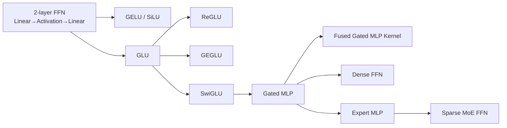

**关系结论：** MLP 是更宽泛的神经网络结构名词；Transformer FFN 是 block 中的 token-wise MLP；Gated MLP 是 FFN 的 gated 实现；MoE 则是**选择多个 FFN/MLP experts 执行**，因此 FFN → MoE 有结构继承关系，但 MoE 还额外引入 router、load balance、dispatch/combine 和 EP。

### Attention Head / KV 表示路线

MQA 让多个 Q heads 共用单组 K/V；GQA 在 MHA 与 MQA 之间选多个 KV groups；MLA 则不只是“更少 KV heads”，而是将 KV 投影压缩为 latent representation，因此其推理 kernel 和 cache layout 明显更复杂。citeturn11academia25turn11academia24turn0academia2

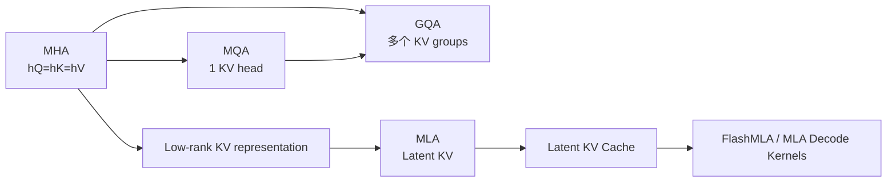

一个非常实用的理解：

\[
\text{MHA/GQA/MQA：主要改变 KV head 数量}
\]

而

\[
\text{MLA：主要改变 KV 的表示空间}
\]

所以 **MLA 不是简单意义上的“GQA 下一代”**。

### Sparse Attention 路线

DSA 在 DeepSeek-V3.2-Exp 中以实验性 sparse attention 发布；DeepSeek-V4 又进一步采用 CSA/HCA 等压缩/索引式注意力结构。V4 的公开 Transformers 实现显示 CSA 使用低压缩池和 Lightning Indexer 做 top-k block selection，而 HCA 使用更高压缩率但不做 index top-k。citeturn1search0turn27view0

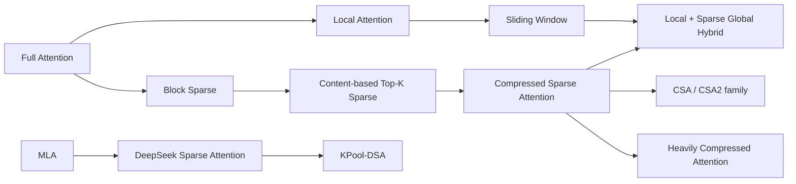

不要把 **Sparse Attention** 和 **Linear Attention** 混为一谈：

\[
\text{Sparse Attention}: \quad
\operatorname{softmax}(QK^T)V
\]

通常仍保留 token-to-token content lookup，只是少算部分位置；

而 linear/recurrent attention 通常把历史聚合成固定或受控大小 state：

\[
S_t = f(S_{t-1}, k_t, v_t), \qquad
o_t = g(q_t,S_t)
\]

因此二者的 cache、prefill kernel、decode kernel 和并行策略都有根本差异。

### Linear Attention / SSM / Hybrid 路线

Gated DeltaNet 将 gating 与 delta-rule state update 结合；Kimi Linear 提出的 KDA 延续这条线路，加入更细粒度 gating 和适合 chunkwise parallel training/prefill 的算法。作者报告的 Kimi Linear hybrid architecture 将 KDA 与 MLA 混合，而不是彻底放弃 Softmax attention。citeturn7academia1turn27view3

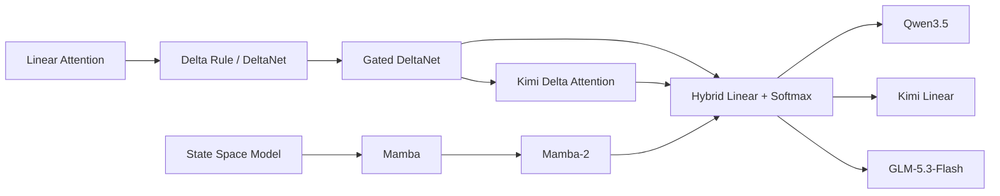

这条路线会直接改变推理引擎的状态管理：系统不再只是维护 paged KV blocks，还必须维护 recurrent state、checkpoint state、prefix state，以及 Softmax/KV 和 recurrent state 的混合生命周期。SGLang 2026 年的 unified radix cache 与 KDA kernel 工作、以及 vLLM 对 hybrid model state 的持续适配，都说明这一问题已经从研究问题变成 serving-engine 问题。citeturn13search1turn25view1turn24view0

### Residual / Norm 路线

HC 与 mHC 是单独于 LayerNorm/RMSNorm 的演进轴，不能简单写成“LayerNorm → mHC”。前者决定 residual streams 如何传播，后者决定每个 sublayer 输入/输出如何归一化。citeturn8academia25turn6academia0

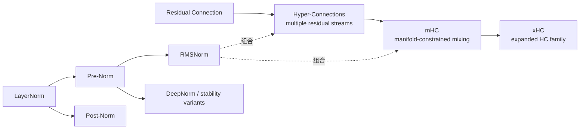

DeepSeek-V4 的 reference implementation 将 residual stream 保持为 `[B,S,hc_mult,D]`，并通过 Sinkhorn-Knopp 得到 doubly-stochastic mixing matrix；这使 mHC 不只是训练技巧，而是会真实改变 inference tensor layout 和 fusion opportunities。citeturn27view0

### MoE 路线

DeepSeekMoE 的两大代表性设计是 fine-grained expert segmentation 和 shared experts；后续系统层优化则围绕 expert placement、load balancing、EP 和 dispatch/combine 展开。citeturn21academia0turn22search0

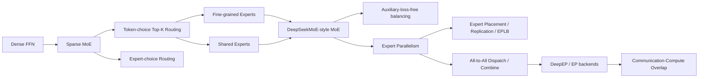

### Position Encoding / Long Context 路线

RoPE 将相对位置信息编码进 Q/K rotation，并成为现代 decoder architecture 的基础位置编码之一。长上下文系统随后出现 NTK scaling、YaRN、LongRoPE 等 extension 方向；但到了 2025–2026 年，真正的长上下文瓶颈越来越不是单纯“position extrapolation”，而是 **attention/state complexity + KV capacity + cache routing**。citeturn10academia1turn27view0

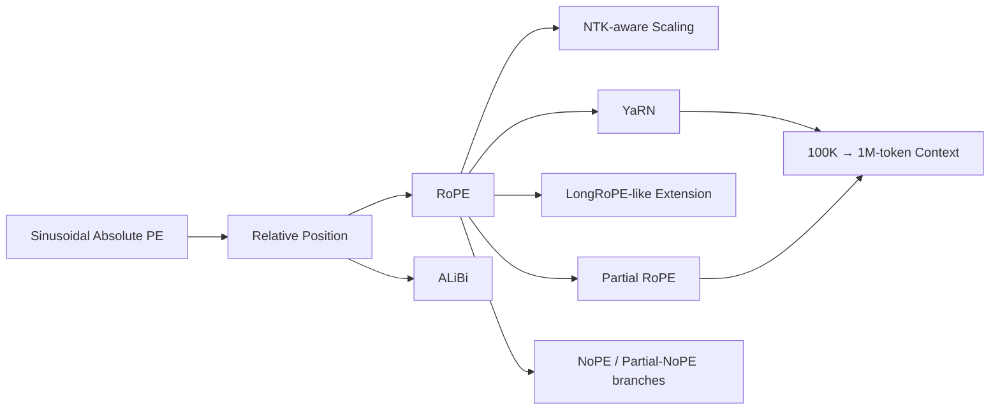

### Scheduling 路线

Orca 将 request-level scheduling 推进到 iteration-level scheduling；Continuous Batching 的核心正是允许 batch 在生成过程中动态变化。之后 PagedAttention、Chunked Prefill 和 async scheduling 进一步把调度粒度压低。citeturn23search10turn12academia0

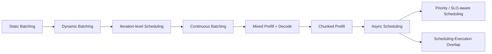

这里有一个重要分界：

**Continuous Batching = 谁进 batch。**

**Chunked Prefill = 一个长 prefill 一次执行多少 token。**

**Async Scheduling = CPU scheduler 是否与 GPU 当前 iteration 并行。**

**TBO = GPU 上不同 micro-batch 的工作如何交叠。**

它们可以同时存在。

### KV Cache / State Management 路线

PagedAttention 将 KV cache 切成 blocks，用 block table 将逻辑地址映射到非连续物理显存，解决动态请求导致的内存浪费与碎片问题；RadixAttention 则进一步把 prefix sharing 变成 runtime 的一级抽象。citeturn12academia0turn12academia2

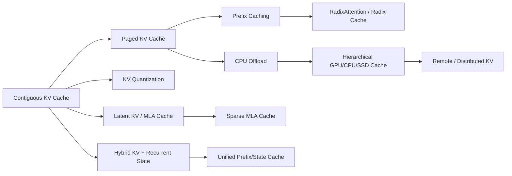

### Parallelism / Disaggregation 路线

PD disaggregation 的核心不是 pipeline parallelism，而是把 prefill 和 decode 放进不同 serving resource pools，使 TTFT 与 TPOT 可以独立优化；代价是必须传输 KV/state。DistServe 是这条路线的重要系统工作。citeturn23academia50

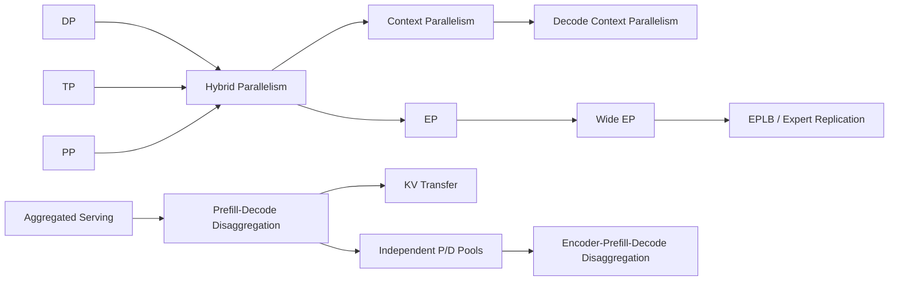

TensorRT-LLM 的文档同样明确区分 context server 与 generation server，并提供 KV connector 机制；这说明 PD 已进入主流 engine architecture，而非只存在于学术 prototype。citeturn26view2

### Kernel / GPU Execution 路线

FlashAttention 的根本创新是 IO awareness：通过 tiling 减少 HBM↔SRAM 数据移动，而不是近似 Softmax Attention；FlashAttention-2 又改进 work partitioning 和并行度。citeturn10academia0turn10academia3

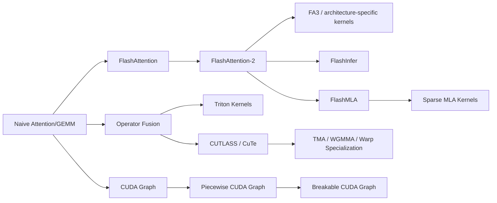

SGLang v0.5.15 已将 Breakable CUDA Graph 设为默认 capture path，并为 prefill 加入 experimental full CUDA graph；较早的 v0.5.13 已把 Piecewise/Breakable graph 扩展到 DSA、Kimi 与 DeepSeek V4 等复杂模型。citeturn25view2

### Speculative Decoding 路线

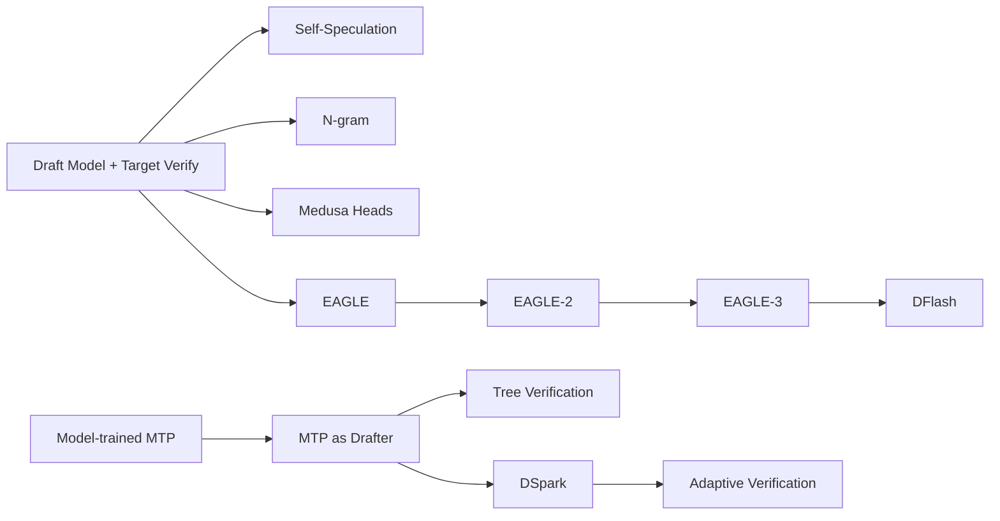

经典 speculative sampling 用小 draft model 提出多 token，再让 target 一次验证，并通过校正采样保持目标分布；Medusa 改为在大模型顶部增加多个 prediction heads；EAGLE 则将 draft 问题转到 feature-level。citeturn12academia3turn13academia14turn13academia12

### Overlap / Pipeline 路线

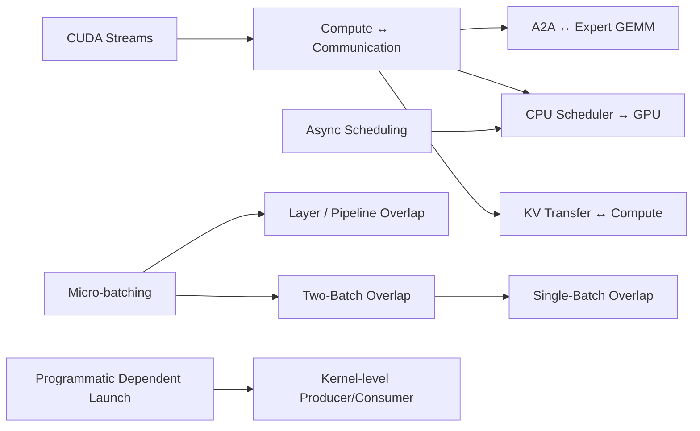

DeepSeek 官方 profiling data 显示，其 V3/R1 serving 在 prefill 和 decode 均使用两个 micro-batches 来隐藏 All-to-All communication；decode 场景中通信发出后可释放 GPU SMs，再与计算交叠。citeturn22search10

### Quantization 路线

GPTQ 是典型 weight-only PTQ；SmoothQuant 将 activation outlier 的量化难度通过等价 scaling 转移到 weights，以支持 W8A8；AWQ 使用 activation statistics 识别重要 weight channels。现代 Blackwell-era serving 又进一步大量出现 FP8、NVFP4、MXFP4 和 quantized KV。citeturn23academia49turn23academia48turn21academia3turn24view0

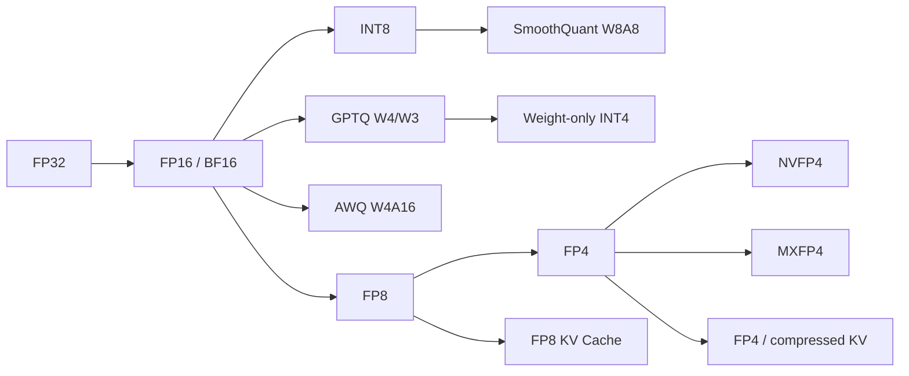

## 技术名词目录样例

下面是第一版的**高密度目录样例**，用于确定最终知识库的 taxonomy。年份以论文首次公开或代表性工程化时间为主；对于没有单一“发明年份”的工程模式，用“~”表示近似成熟时间。基础技术的脉络以 Transformer、MQA/GQA、FlashAttention、Orca、PagedAttention、SGLang 等一手资料为锚点；2024–2026 新节点则优先以模型 config、论文和 release notes 为准。citeturn0academia0turn11academia25turn11academia24turn10academia0turn23search10turn12academia0turn12academia2turn24view0turn25view0

### 模型结构与 Attention

| 名词 | 年 | 优先级 | 一句话定位 | 代表关联 |
|---|---:|---|---|---|
| Transformer | 2017 | P0 | Attention+FFN+Residual 构成的序列建模骨架 | 所有主流 LLM citeturn0academia0 |
| Decoder-only Transformer | ~2018 | P0 | 只保留 causal decoder stack 的生成式结构 | GPT/Llama |
| Causal LM | ~2018 | P0 | 按左到右条件概率生成 token | GPT/Llama |
| Transformer Block | 2017 | P0 | Attention 与 FFN 组成的重复计算单元 | Transformer |
| MHA | 2017 | P0 | 各 head 使用独立 Q/K/V | 原始 Transformer citeturn0academia0 |
| MQA | 2019 | P0 | 多 Q heads 共享一组 KV | Decode/KV 优化 citeturn11academia25 |
| GQA | 2023 | P0 | Q heads 分组共享 KV | Llama 系列等 citeturn11academia24 |
| MLA | 2024 | P0 | 用低维 latent 表示 KV | DeepSeek-V2/V3 citeturn0academia2 |
| Latent KV Cache | 2024 | P1 | 缓存压缩 latent 而非完整 K/V | MLA |
| Full Attention | 2017 | P0 | 每个 query 看全部历史 token | Transformer |
| Local Attention | ~2020 | P1 | 每个 token 只访问局部范围 | 长上下文 |
| Sliding Window Attention | ~2020 | P1 | 固定滑窗局部 Attention | Mistral/Hybrid |
| Block Sparse Attention | ~2020 | P1 | 以 block 为粒度稀疏化 QK | 长上下文 |
| DSA | 2025 | P1 | DeepSeek 的内容选择稀疏 Attention | V3.2-Exp citeturn1search0 |
| KPool-DSA | 2026 | P1 | 先 pool 再索引 DSA 候选位置 | GLM-5.3-Flash citeturn28view0 |
| CSA | 2026 | P1 | 压缩历史再由 indexer 选择 top-k entries | DeepSeek-V4 citeturn27view0 |
| HCA | 2026 | P1 | 高压缩率全量访问 compressed entries | DeepSeek-V4 citeturn27view0 |
| Attention Sink | ~2023 | P1 | 给 Attention 提供稳定 sink/吸收位置 | 长上下文/V4 |
| Linear Attention | ~2020 | P1 | 用可结合 kernel/state 重写 attention | Hybrids |
| Delta Rule | ~2021 | P1 | 以误差/增量方式更新 recurrent memory | DeltaNet |
| Gated DeltaNet | 2024 | P1 | gating + delta update 的 recurrent attention | Qwen3.5 lineage citeturn7academia1 |
| KDA | 2025 | P1 | 更细粒度 gated delta attention | Kimi Linear/GLM citeturn27view3turn28view0 |
| Recurrent State | — | P0 | Decode 时固定状态更新而非增长 KV | Linear/SSM |
| Hybrid Attention | ~2024 | P0 | Linear/local/global attention 交替组合 | Qwen3.5/GLM/V4 |
| Mamba | 2023 | P1 | Selective state-space architecture | SSM |
| Mamba-2 | 2024 | P1 | SSM/structured state-space 的进一步工程化 | Hybrid models |
| RWKV | 2021 | P2 | RNN-like recurrent inference 的 Transformer alternative | RWKV |
| RetNet | 2023 | P2 | Parallel/recurrent dual-mode retention | RetNet |

Gated DeltaNet → KDA 的关系尤其值得记住：**KDA 是 GDN 技术谱系中的细粒度 gating/state-update 改进，而不是 GLM 独立发明的某种 KV cache。** Kimi Linear 是其原始主要来源；GLM-5.3-Flash 后来将 KDA 大规模用于 34/45 decoder layers。citeturn7academia1turn27view3turn28view0

### FFN、Residual、MoE 与 Position

| 名词 | 年 | 优先级 | 一句话定位 | 代表关联 |
|---|---:|---|---|---|
| FFN | 2017 | P0 | Transformer 中逐 token 两层 MLP | Transformer citeturn0academia0 |
| MLP | — | P0 | 多层全连接网络的总称 | FFN/Expert |
| ReLU | — | P0 | 原始 Transformer FFN 激活之一 | Transformer |
| GELU | — | P0 | 平滑激活，BERT/GPT 系常见 | Dense LLM |
| SiLU / Swish | — | P0 | \(x\sigma(x)\) 激活 | SwiGLU |
| GLU | — | P0 | 一条 projection gate 另一条 projection | Gated MLP |
| GEGLU | 2020 | P1 | GELU gate 的 GLU | Transformer FFN citeturn0academia3 |
| SwiGLU | 2020 | P0 | Swish/SiLU gate 的 GLU | Llama/DeepSeek citeturn0academia3 |
| Gated MLP | 2020 | P0 | 两上投影相乘再 down-project | 现代 LLM |
| Fused Gated MLP | ~2023 | P1 | 将 gate/up/activation 融合执行 | 推理 kernel |
| Dense FFN | 2017 | P0 | 所有 token 使用同一 FFN | Dense model |
| Sparse MoE | ~2017 | P0 | token 只激活少数 experts | Mixtral/DeepSeek |
| Top-K Routing | — | P0 | 每 token 选择得分最高 K 个 experts | MoE |
| Shared Expert | 2024* | P1 | 所有 token 均执行的共享 expert | DeepSeekMoE citeturn21academia0 |
| Fine-Grained Expert | 2024 | P1 | 把大 expert 切成更多细粒度 experts | DeepSeekMoE citeturn21academia0 |
| Expert Replication | — | P1 | 热 expert 在多设备复制 | Large-scale EP |
| EPLB | ~2025 | P1 | 根据负载重新放置/复制 expert | SGLang/DeepSeek citeturn25view3 |
| Residual Connection | 2015/17 | P0 | \(x+F(x)\) 信息高速通路 | Transformer |
| Post-Norm | 2017 | P0 | sublayer 后做 normalization | 原始 Transformer |
| Pre-Norm | ~2019 | P0 | sublayer 前 normalization | 现代 LLM |
| RMSNorm | 2019 | P0 | 不减均值的 RMS normalization | Llama/DeepSeek |
| Hyper-Connections | 2024 | P1 | 将单 residual stream 扩为多动态 stream | HC citeturn8academia25 |
| mHC | 2025 | P1 | 对 HC mixing 施加流形/双随机约束 | DeepSeek-V4 citeturn6academia0turn27view0 |
| xHC | 2026 | P2 | 扩展 HC width/效率的后续路线 | Research citeturn6academia1 |
| Sinkhorn-Knopp | — | P1 | 迭代归一化得到 doubly-stochastic matrix | mHC |
| Sinusoidal PE | 2017 | P0 | 原始 absolute positional encoding | Transformer |
| RoPE | 2021 | P0 | 旋转 Q/K 编入 relative position | 主流 LLM citeturn10academia1 |
| ALiBi | 2021 | P1 | attention score 上加入线性位置 bias | 长上下文 |
| NTK Scaling | ~2023 | P1 | 修改 RoPE scale 扩展 context | Long context |
| YaRN | 2023 | P1 | RoPE extrapolation/scaling 方法 | 长上下文 |
| Partial RoPE | — | P1 | 只旋转 head 的部分维度 | DeepSeek-V4 citeturn27view0 |
| NoPE | — | P2 | 部分 attention 分支不使用 position encoding | Sparse/hybrid |

\* Shared expert 思想并非 2024 才出现；这里的 2024 指 DeepSeekMoE 这一现代代表性设计节点。citeturn21academia0

### 推理基础、调度与指标

| 名词 | 年 | 优先级 | 一句话定位 |
|---|---:|---|---|
| Prefill | — | P0 | 一次处理 prompt，多 token 并行，通常更偏 compute-bound |
| Decode | — | P0 | 每轮生成少量 token，权重/KV 读取占比高 |
| TTFT | — | P0 | 请求到首 token 的延迟 |
| TPOT | — | P0 | 稳态每 token 时间 |
| ITL | — | P0 | inter-token latency |
| Throughput | — | P0 | 单位时间生成 token/request 数 |
| Goodput | ~2023 | P1 | 满足 SLO 的有效吞吐 |
| Arithmetic Intensity | — | P0 | FLOPs / memory bytes |
| Roofline Model | — | P0 | 分析 bandwidth/compute ceiling |
| GEMM | — | P0 | 矩阵×矩阵核心计算 |
| GEMV | — | P0 | 矩阵×向量，小 batch decode 常接近此形态 |
| Grouped GEMM | — | P1 | 不同 shape/expert GEMM 聚合执行 |
| Static Batching | — | P0 | batch 生命周期固定 |
| Dynamic Batching | — | P0 | 启动前动态聚合请求 |
| Iteration-level Scheduling | 2022 | P0 | 每生成 iteration 重组工作 | Orca citeturn23search10 |
| Continuous Batching | 2022 | P0 | 生成途中动态加入/移出请求 | Orca/vLLM |
| Chunked Prefill | ~2023 | P0 | 长 prompt 切 chunk 与其他请求混合执行 |
| Mixed Prefill-Decode | — | P1 | 同一 step 包含 prefill/decode tokens |
| Request Preemption | — | P1 | KV/调度压力下暂停或驱逐请求 |
| Priority Scheduling | — | P1 | 根据请求优先级调整 admission/order |
| Async Scheduling | ~2024 | P1 | CPU 下一步调度与 GPU 当前 step 交叠 |
| Prefix-aware Routing | ~2024 | P1 | 根据 cache locality 选择 replica |
| Zero-overhead Scheduling | — | P2 | 尽量把 CPU scheduler 开销隐藏或下沉 |
| Agentic Scheduling | ~2025 | P1 | 针对大量短轮次/共享前缀 agent workload 的调度 |

Prefill 与 decode 的“compute-bound / memory-bound”是非常有用的第一近似，但不是不可变定律；模型结构、batch、context、MoE、量化和硬件都会改变 operational intensity。因此工程上应以 profile/roofline 为准，而不是把“decode 永远 memory-bound”当成定理。

### KV、缓存和 Serving

| 名词 | 年 | 优先级 | 一句话定位 | 代表实现 |
|---|---:|---|---|---|
| KV Cache | — | P0 | 保存历史 K/V 避免 autoregressive 重算 | 所有 Transformer serving |
| Paged KV Cache | 2023 | P0 | block/page 化动态 KV | vLLM citeturn12academia0 |
| PagedAttention | 2023 | P0 | 支持 paged KV addressing 的 attention/runtime | vLLM |
| Prefix Caching | — | P0 | 跨请求重用共享前缀状态 | vLLM/SGLang |
| RadixAttention | 2023 | P0 | radix tree 管理共享 prefix KV | SGLang citeturn12academia2 |
| Radix Cache | 2023 | P0 | RadixAttention 的 runtime cache 结构 | SGLang |
| KV Quantization | — | P1 | 用 FP8/INT8/FP4 等保存 KV |
| KV Compression | — | P1 | 算法性减少 state dimension/entries | MLA/CSA |
| KV Eviction | — | P1 | 内存不足时淘汰低价值 blocks |
| CPU KV Offload | — | P1 | GPU 不活跃 KV 移至 host |
| SSD KV Offload | — | P2 | 更大容量低速 tier |
| Hierarchical KV Cache | ~2024 | P1 | GPU/CPU/SSD 等分层 cache |
| Remote KV Cache | ~2024 | P1 | KV 存储在另一进程/节点 |
| KV Transfer | — | P1 | 在 prefill/decode workers 间移动 state |
| KV Connector | ~2025 | P1 | runtime 抽象化状态传输接口 | TRT-LLM/vLLM ecosystem |
| MLA Latent Cache | 2024 | P1 | 保存 MLA compressed latent | DeepSeek |
| Recurrent State Cache | ~2024 | P1 | 保存 GDN/KDA/Mamba 固定状态 |
| Hybrid State Cache | ~2025 | P1 | 同时管理 KV + recurrent state |
| Unified Radix Cache | 2026 | P2 | 一个 prefix tree 协调不同 layer state | SGLang citeturn13search1 |
| PD Disaggregation | 2024 | P1 | Prefill 与 decode 分离资源池 | DistServe 等 citeturn23academia50 |
| KV-aware Routing | ~2024 | P1 | 按已有 KV locality 路由请求 | PD serving |
| Encoder-Prefill-Decode Disaggregation | ~2025 | P2 | VLM/多阶段模型拆成多个资源池 | modern serving |

### Kernel、执行与分布式

| 名词 | 年 | 优先级 | 一句话定位 |
|---|---:|---|---|
| FlashAttention | 2022 | P0 | IO-aware exact attention citeturn10academia0 |
| FlashAttention-2 | 2023 | P0 | 更好的 warp/block work partitioning citeturn10academia3 |
| FlashDecoding | ~2023 | P1 | 面向长 KV decode 的并行 attention |
| FlashInfer | ~2023 | P1 | serving-oriented attention/LLM kernel library |
| FlashMLA | ~2025 | P1 | MLA/稀疏 MLA 高性能 kernel |
| FlashKDA | 2026 | P1 | KDA prefill optimized backend | SGLang citeturn25view2 |
| Triton | — | P0 | Python DSL GPU kernel stack |
| CUTLASS | — | P1 | NVIDIA GEMM/kernel template library |
| CuTe / CuTe DSL | — | P1 | tile/layout oriented GPU programming |
| TMA | 2022+ | P1 | Hopper tensor memory accelerator |
| WGMMA | 2022+ | P1 | Hopper warp-group matrix ops |
| Warp Specialization | — | P1 | 不同 warp 承担 load/compute 等角色 |
| Kernel Fusion | — | P0 | 消除 intermediate IO/launch overhead |
| Persistent Kernel | — | P1 | kernel 长驻 GPU，减少 launch/sync |
| CUDA Graph | — | P0 | replay 已捕获 GPU execution graph |
| Piecewise CUDA Graph | ~2025 | P1 | 只 graph-capture 可稳定区域 |
| Breakable CUDA Graph | ~2026 | P1 | 可在动态节点断开/恢复 capture | SGLang citeturn25view2 |
| TP | — | P0 | 单 layer tensor 维度切分 |
| PP | — | P0 | layer/stage 切分 |
| DP | — | P0 | 模型副本并行 |
| EP | — | P0 | experts 跨 GPU 分片 |
| CP | — | P1 | sequence/context 维度并行 |
| DCP | ~2025 | P1 | decode context parallelism |
| Sequence Parallelism | — | P1 | sequence/token 维度拆分局部算子 |
| All-Reduce | — | P0 | 聚合所有 rank tensor |
| All-Gather | — | P0 | 收集各 rank shard |
| Reduce-Scatter | — | P0 | reduce 后按 rank 分片 |
| All-to-All | — | P0 | EP token dispatch 的核心 collective |
| NCCL | — | P0 | NVIDIA GPU collective communication |
| DeepEP | 2025 | P1 | MoE EP dispatch/combine 通信栈 citeturn22search0 |
| MoonEP | ~2026 | P2 | 新一代 EP / expert balancing backend | vLLM v0.31 citeturn24view0 |

### Speculative、Overlap 与低精度

| 名词 | 年 | 优先级 | 一句话定位 |
|---|---:|---|---|
| Speculative Decoding | 2023 | P0 | draft 多 token + target 批量 verify citeturn12academia3 |
| Draft Model | 2023 | P0 | 低成本 proposal model |
| N-gram Speculation | ~2023 | P1 | 从已有 token pattern 猜后续 token |
| Self-Speculation | ~2023 | P1 | 同一模型自身产生 draft |
| Medusa | 2024 | P1 | 多个额外 decoding heads 并行预测未来 token citeturn13academia14 |
| EAGLE | 2024 | P1 | feature-level autoregressive draft citeturn13academia12 |
| EAGLE-2/3 | 2024–25 | P1 | EAGLE 的 tree/drafter 改进 |
| MTP | ~2024 | P0 | 模型原生训练预测多个未来 token |
| Tree Attention | — | P1 | 一次验证 draft tree 的共享前缀 |
| Adaptive Verification | ~2026 | P2 | 根据 acceptance 动态控制 verify |
| DFlash | ~2026 | P2 | 新型 draft/spec execution path | vLLM/SGLang |
| DSpark | 2026 | P2 | adaptive speculative verification family | vLLM/SGLang citeturn24view0turn25view1 |
| Compute-Communication Overlap | — | P0 | 通信藏在独立计算后面 |
| CPU-GPU Overlap | — | P0 | host scheduler 与 GPU execution 并行 |
| H2D/D2H Overlap | — | P1 | PCIe/NVLink transfer 与 compute 并行 |
| Prefill-Decode Overlap | — | P1 | 不同阶段或 microbatch 并行 |
| A2A-GEMM Overlap | — | P1 | EP dispatch/combine 与 expert compute 交叠 |
| TBO | ~2025 | P1 | 两 micro-batch 交错 attention 与 EP communication | SGLang citeturn25view3 |
| SBO | ~2025 | P1 | 单 batch 内 shared expert 等独立计算藏通信 | SGLang citeturn25view4 |
| Async Collective | — | P0 | collective launch 后延迟等待 |
| CUDA Stream Overlap | — | P0 | 利用独立 streams 并行 GPU work |
| PDL | — | P2 | kernel launch 依赖细粒度化 |
| BF16 | — | P0 | 训练/推理常见 16-bit float |
| FP8 | ~2022 | P1 | 8-bit floating-point execution/storage |
| GPTQ | 2022 | P1 | second-order weight-only PTQ citeturn23academia49 |
| SmoothQuant | 2022 | P1 | 将 activation outlier 难度迁移到 weights 的 W8A8 PTQ citeturn23academia48 |
| AWQ | 2023 | P1 | activation-aware weight-only quantization citeturn21academia3 |
| INT4 / W4A16 | — | P1 | 4-bit weights + 16-bit activation |
| NVFP4 | ~2025 | P1 | NVIDIA Blackwell-oriented FP4 format |
| MXFP4 | ~2025 | P1 | microscaling FP4 format |
| KV FP8 | ~2024 | P1 | KV cache 使用 FP8 |
| KV FP4 | ~2026 | P2 | 更激进的 compressed/low-bit KV |

这一版目录已经足够作为**taxonomy 骨架**；实际长期知识库不应追求机械地堆到 300 个词，而应该围绕“一个节点是否改变模型计算图、状态布局、kernel interface 或 runtime 行为”决定是否独立建节点。

## 重点技术卡片

下面选取第一版最值得先建立“肌肉记忆”的重点技术。卡片中的性能数字若出现，均区分论文/作者报告与工程实现，不把作者 benchmark 当作普遍保证。

### Multi-Query Attention 与 Grouped-Query Attention

| 字段 | 内容 |
|---|---|
| 名称 | MQA / GQA |
| 分类 | 模型架构 · KV 表示 |
| 首次提出 | MQA 2019；GQA 2023 |
| 核心问题 | Decode 阶段读取 KV cache 带宽太大 |
| 原理 | MQA 共享一组 KV；GQA 让多个 Q heads 共用一个 KV group |
| 前驱 | MHA |
| 后续 | MLA 等更激进 KV representation |
| 性能影响 | KV 容量下降，decode memory traffic 减少 |
| 优先级 | P0 |

MQA 的核心不是减少 query heads，而是共享 K/V；GQA 在 MHA 质量和 MQA 带宽之间提供中间点。GQA 原论文报告其能以接近 MHA 的质量获得接近 MQA 的速度。citeturn11academia25turn11academia24

### MLA

| 字段 | 内容 |
|---|---|
| 名称 | Multi-Head Latent Attention |
| 分类 | 架构 · Attention/KV |
| 首次代表 | DeepSeek-V2，2024 |
| 核心问题 | 长上下文/大 batch 下 KV cache 容量和 bandwidth |
| 核心机制 | 将 K/V 投影压缩为 latent representation；计算时恢复/吸收 projection |
| 前驱 | MHA/GQA + low-rank projection |
| 关联 | FlashMLA、Latent Cache、DSA |
| 优先级 | P0 |

DeepSeek-V2 将 MLA 与 DeepSeekMoE 同时引入；其 technical report 报告 MLA 大幅降低 KV cache，并成为之后 DeepSeek-V3 系 architecture 的关键推理特征。citeturn0academia2

从推理工程角度，MLA 最关键的一点是：

> **它把“KV cache 优化”从 runtime memory allocator 问题升级成模型表示问题。**

因此 PagedAttention 与 MLA 并不互相替代：一个解决 cache allocation/layout，一个减少每 token 需要保存的内容。

### DSA

| 字段 | 内容 |
|---|---|
| 名称 | DeepSeek Sparse Attention |
| 分类 | 架构 · Sparse Attention |
| 首次公开 | 2025，DeepSeek-V3.2-Exp |
| 核心问题 | 长序列中 Full/MLA attention 仍需访问过多历史 |
| 原理 | 用 indexer 选高相关历史位置，仅对稀疏候选执行核心 attention |
| 前驱 | MLA + sparse retrieval |
| 成熟度 | 从实验性路线逐渐工程化 |
| 优先级 | P1 |

DeepSeek 在 2025 年 9 月公开 V3.2-Exp 时明确将 DSA 标为探索性 sparse attention 技术；这也是“MLA → DSA”最准确的理解：**MLA 优化保存什么，DSA 优化读取哪些。** citeturn1search0turn1search1

### Gated DeltaNet

Gated DeltaNet 组合了两种 recurrent-memory 思想：gating 负责衰减/遗忘 state，delta rule 根据当前 prediction error 式增量更新 memory。作者实验还研究了与 sliding-window attention/Mamba2 的 hybrid 组合。citeturn7academia1

最简抽象可写成：

\[
S_t = \alpha_t S_{t-1}
      + \beta_t (v_t-\hat v_t)k_t^\top
\]

\[
o_t=q_t^\top S_t
\]

真实算法会更复杂，但这个式子足够帮助推理工程师建立直觉：

**KV Attention 保存 token history；GDN 保存“汇总后的动态 memory matrix”。**

所以 decode state size 可以与 sequence length 解耦。

### Kimi Delta Attention

| 字段 | 内容 |
|---|---|
| 名称 | Kimi Delta Attention, KDA |
| 分类 | Linear/Recurrent Attention |
| 首次代表 | Kimi Linear，2025 |
| 前驱 | Gated DeltaNet / Delta rule |
| 核心变化 | 更细粒度 gating + 高效 chunkwise algorithm |
| 典型模型 | Kimi Linear；GLM-5.3-Flash |
| 工程实现 | FLA、FlashKDA、vLLM/SGLang model-specific kernels |
| 优先级 | P1 |

Kimi Linear 的作者把 KDA 描述为 Gated DeltaNet 的扩展，并报告 hybrid KDA/MLA architecture 在超长上下文上的 KV/state 与 decoding throughput 优势；这些数字属于**作者实验结果**，不能直接外推到任意 workload。citeturn27view3

2026 年 KDA 已不是单模型特性：GLM-5.3-Flash 的公开 NeMo reference 显示，它的 decoder 为 **34 KDA + 11 KPool-DSA**，即三个 KDA layer 后周期性插入一个稀疏 Softmax/DSA layer。citeturn28view0

### Hybrid Attention

Hybrid Attention 的核心不是某一种 attention operator，而是一种 architecture policy：

\[
\underbrace{L,L,L}_{cheap\ state}
\rightarrow
\underbrace{G}_{global/content\ retrieval}
\rightarrow
L,L,L
\rightarrow G
\]

其中 \(L\) 可以是 GDN/KDA/Mamba/SWA，\(G\) 可以是 GQA/MLA/DSA。

Qwen3.5-9B 的官方 model card 给出的布局恰好是：

\[
8 \times
(3\times(\text{Gated DeltaNet}\rightarrow FFN)
+
1\times(\text{Gated Attention}\rightarrow FFN))
\]

并同时训练 MTP。citeturn28view2

这类模型会迫使推理引擎解决过去不存在的问题：

**KV block 与 recurrent state 如何共同分配？prefix cache 如何命中？preemption 如何恢复 state？speculative verify 后哪个 recurrent state 应 commit？**

这也是 2026 年推理引擎中最值得跟踪的方向之一。citeturn25view1turn24view0

### Hyper-Connections 与 mHC

传统 residual：

\[
x_{l+1}=x_l+F_l(x_l)
\]

HC 不再只有一条 \(x\)，而维护多个 residual streams：

\[
X_l\in\mathbb{R}^{n\times d}
\]

并学习不同 stream 如何读入、写回和混合。citeturn8academia25

mHC 的核心不是“多一层 normalization”，而是限制 residual mixing matrix 的几何性质。DeepSeek-V4 的公开实现通过 Sinkhorn-Knopp 产生 doubly-stochastic combination matrix，并维持多个 residual streams。citeturn6academia0turn27view0

推理上的新成本包括：

\[
[B,S,D] \rightarrow [B,S,n_{hc},D]
\]

以及额外 mixing、projection 和 collective/fusion opportunities。这也是为什么 vLLM v0.31 针对 DeepSeek-V4.1 增加了 fused TP all-reduce + mHC input preparation 等专门优化。citeturn24view0

### DeepSeekMoE

DeepSeekMoE 主要解决传统 MoE expert specialization 不充分的问题。两个核心点是：

**fine-grained segmentation**：把较大的 experts 拆成更多小 experts，再激活更多小 experts；

**shared expert isolation**：把通用知识交给 shared experts，减少 routed experts 间冗余。citeturn21academia0

从 serving 角度，这会进一步增加：

\[
\text{routing}
\rightarrow
\text{permutation}
\rightarrow
\text{all-to-all}
\rightarrow
\text{grouped GEMM}
\rightarrow
\text{combine}
\]

的复杂度。

因此“MoE 推理优化”不能只看 FusedMoE kernel。

### PagedAttention

PagedAttention 借鉴 virtual memory paging 的思想，将每请求 KV cache 拆成固定大小 blocks，由 logical block table 映射 physical blocks，使请求无需预留连续、最大长度的 KV memory。原论文报告显著减少 KV waste，并在其 workload 上获得相对当时系统的吞吐提升。citeturn12academia0

关键认知：

**PagedAttention ≠ 更快的 Softmax algorithm。**

它本质上是：

\[
\text{KV Memory Virtualization}
+
\text{Paged Addressing Attention Kernel}
\]

所以 FlashAttention 与 PagedAttention 可以结合。

### RadixAttention

RadixAttention 使用 radix tree 将共享 prompt/prefix 对应的 KV cache 组织成可复用节点，并让 scheduler/cache eviction 与 prefix tree 联动。它是 SGLang 最具代表性的系统设计之一。citeturn12academia2

PagedAttention 和 RadixAttention 的区别可以一句话概括：

> **PagedAttention 首先解决“KV 怎么放”；RadixAttention 首先解决“哪些请求可以共享 KV”。**

两者不是同一层 abstraction。

### FlashAttention

标准 attention 中最昂贵的不只有 FLOPs，还有 HBM 中间 tensor IO。FlashAttention 通过 tiling、online softmax 和 SRAM reuse，在保持 exact attention 的情况下减少 HBM traffic。citeturn10academia0

所以：

\[
\text{FlashAttention}
\neq
\text{Sparse Attention}
\]

前者改变**执行算法**，后者改变**计算图中哪些 QK pair 存在**。

FlashAttention-2 再改善线程块/warp 间 work partitioning 与并行性。citeturn10academia3

### Continuous Batching

Orca 的 iteration-level scheduling 将一次 generation 从“整个请求不可拆”变为“每个 decode iteration 都可重新组 batch”。citeturn23search10

传统：

```text
Batch A: req1 ────────────────────────
         req2 ─────────────
         req3 ──────────────────
         下一批必须等待慢请求
```

Continuous:

```text
Step 1: req1 req2 req3
Step 2: req1 req2 req3
Step 3: req1 req4 req3
Step 4: req1 req4 req5
```

这项技术是后来 PagedAttention、高并发 serving 和 token-level scheduler 的基础之一。

### Prefill-Decode Disaggregation

DistServe 指出了 colocated serving 的核心问题：prefill 和 decode 的 optimal resource/parallelism 不相同，而且 prefill burst 会干扰 TPOT。其方案将两个阶段放在不同 GPU，通过 KV transfer 连接。citeturn23academia50

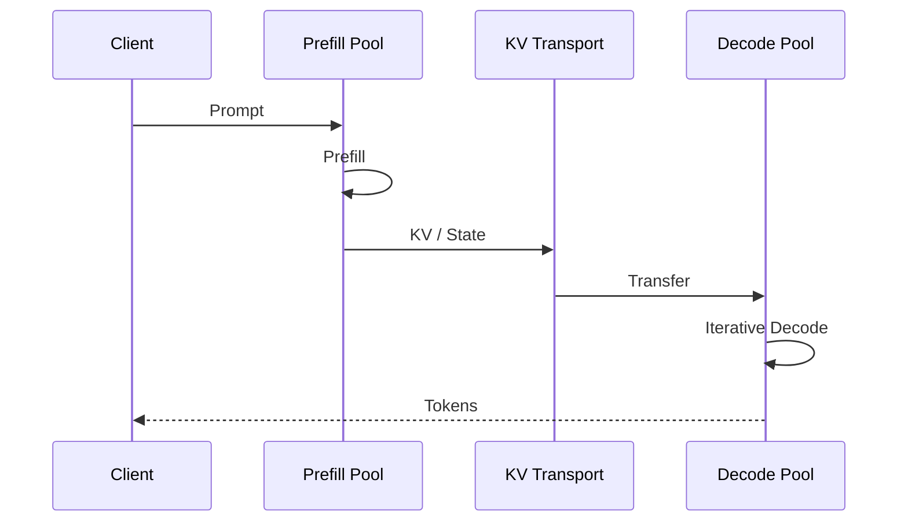

PD 的收益条件高度依赖：

\[
T_{\text{saved interference}}
>
T_{\text{KV transfer}}
+
T_{\text{routing}}
+
T_{\text{queue}}
\]

因此并不是任何小模型、短 prompt 都适合拆分。

### DeepEP

DeepEP 是针对 MoE expert parallel dispatch/combine 的高性能通信库。当前官方 repo 提供高吞吐和低延迟 EP primitives、FP8 dispatch、异步 event、deferred epilogue，并明确暴露 communication-compute overlap 接口。citeturn22search0

它的关键抽象可以看成：

```text
dispatch async
    ↓
independent compute
    ↓
wait
    ↓
expert GEMM
    ↓
combine async
    ↓
independent compute
    ↓
wait
```

所以 DeepEP 不是“NCCL 的别名”；它针对 MoE routing layout、dispatch/combine 和 overlap 做了更专门的设计。citeturn22search0

### CUDA Graph、Piecewise Graph 与 Breakable Graph

传统 CUDA Graph 最大问题是动态 serving graph 不稳定：batch size、prefill/decode、MoE routing、sparse indexer、speculation 都可能改变执行路径。

因此工程趋势从：

\[
\text{Full static CUDA Graph}
\]

走向：

\[
\text{piecewise stable regions}
\]

甚至允许在动态节点 break/re-enter graph。

SGLang v0.5.15 已将 Breakable CUDA Graph 作为默认 capture path；v0.5.13 已扩展 PCG/BCG 到 DSA/Kimi/DeepSeek-V4 等复杂 workload。citeturn25view2

### Classical Speculative Decoding

设 draft 模型为 \(q\)，target 为 \(p\)。Draft 一次生成多个候选：

\[
x_{t+1},x_{t+2},...,x_{t+k}
\]

target 一次 forward 批量验证这些位置。

经典算法并不是“target 相信 draft”，而是通过 rejection/correction 保持目标分布，因此理论上可以在不改变 target distribution 的情况下减少 target 的串行 forward 次数。citeturn12academia3

收益大致取决于：

\[
\text{speedup}
\sim
\frac{\text{accepted tokens}}
{\text{draft cost}+\text{verification cost}}
\]

所以高 batch 时 target 本来就利用率很高，speculation 收益通常更难获得；TensorRT-LLM 官方文档也明确指出 speculative decoding 更常在低 batch/concurrency 下体现加速。citeturn17search2

### EAGLE

EAGLE 不直接只预测 token，而是在 target model 的高层 feature space 中预测下一步 feature，并使用 token sampling 提供额外信息。原论文将其定位为 training-efficient speculative decoding method。citeturn13academia12

从工程角度它带来的新问题是：

**target hidden states 是否暴露？drafter KV 如何维护？tree 怎么组织？verify CUDA graph 如何 capture？**

这也是 EAGLE 系方法落地到 serving engine 后复杂度明显高于简单 n-gram speculation 的原因。

### AWQ、GPTQ 与 SmoothQuant

三者必须分开：

**GPTQ**：以 approximate second-order information 做一次性 weight quantization，典型是 W4/W3。citeturn23academia49

**AWQ**：用 activation statistics 识别 salient weight channels，再做等价 scaling，仍主要是 weight-only。citeturn21academia3

**SmoothQuant**：核心目标是 W8A8，将 activation outlier 的难度离线迁移到 weights。citeturn23academia48

所以它们的坐标是：

| 方法 | Weight | Activation | 核心难点 |
|---|---|---|---|
| GPTQ | 低 bit | 高精度 | Weight reconstruction |
| AWQ | 低 bit | 高精度 | Protect salient channels |
| SmoothQuant | INT8 | INT8 | Activation outlier |

## 现代模型与推理引擎矩阵

### 模型 × 架构 × 推理适配

截至 2026 年，最值得关注的不是“谁参数更多”，而是模型开始直接提出新的 runtime abstraction。尤其 DeepSeek-V4、Qwen3.5、GLM-5.3-Flash 已经明显脱离“标准 GQA Transformer + MoE”的简单模式。citeturn27view0turn28view2turn28view0

| 模型/系列 | Attention / State | FFN/MoE | Residual | 原生加速结构 | 推理主要挑战 |
|---|---|---|---|---|---|
| Llama 系 | MHA→GQA | Dense SwiGLU | PreNorm/RMSNorm | — | 标准 paged KV，生态基线 |
| Mistral | GQA + SWA 等 | Dense SwiGLU | RMSNorm | — | sliding-window cache |
| Mixtral | GQA/SWA | Sparse MoE | RMSNorm | — | Expert routing/EP |
| DeepSeek-V2 | MLA | DeepSeekMoE | 标准 residual | — | Latent KV、MLA kernel citeturn0academia2 |
| DeepSeek-V3 | MLA | Fine-grained/shared expert MoE | 标准 residual | MTP | MLA+MoE+MTP |
| DeepSeek-V3.2 | MLA + DSA | MoE | 标准 residual | MTP | Sparse indexer + sparse MLA citeturn1search0 |
| DeepSeek-V4 | SWA + CSA/HCA，MQA-like compressed branches | Hash-MoE bootstrap + routed MoE | **mHC** | MTP config | compressed state、indexer、mHC stream、MoE citeturn27view0 |
| DeepSeek-V4.1-Flash | V4-family compressed/sparse attention | MoE | mHC | Spec-friendly | FP4/compressed KV、specialized sparse kernels；vLLM 已做专项优化 citeturn24view0 |
| Qwen3.5-9B | **3 GDN : 1 Gated Attention** | Dense FFN | 主流 norm/residual | MTP | recurrent state + KV 混合 cache citeturn28view2 |
| Kimi Linear | **KDA + MLA Hybrid** | 模型相关 | 模型相关 | — | KDA chunk/recurrent kernel + hybrid state citeturn27view3 |
| GLM-5.3-Flash | **34 KDA + 11 KPool-DSA** | 288 routed/top-8 + shared expert | **4-stream mHC** | MTP 路径已进入 serving | KDA + sparse MLA + MoE + mHC 四重适配 citeturn28view0turn25view0 |
| Kimi K3 | 新式 hybrid/state model | MoE family | model-specific | DSpark/variable decode integration | state cache/speculation/model-specific kernel；vLLM/SGLang 已专项支持 citeturn24view0turn25view0 |

### DeepSeek-V4 是一个很好的“2026 架构复杂度样本”

其公开 Transformers reference 同时出现：

`SWA + CSA/HCA + shared K=V MQA + partial RoPE + attention sink + grouped output projection + mHC + Hash-MoE bootstrap + top-k MoE + shared expert + SwiGLU + MTP config`

这意味着一个现代 engine 在“支持一个模型”时，实际上可能需要修改：

```text
Model Loader
   ↓
Model Runner
   ↓
Attention Backend
   ↓
KV/State Manager
   ↓
MoE Backend
   ↓
Collectives
   ↓
CUDA Graph Strategy
   ↓
Speculative Path
   ↓
Scheduler
```

而不是写一个新的 `model.py` 就结束。citeturn27view0turn24view0

### 推理引擎总体定位

截至截止日，vLLM v0.31.0 的 release notes 显示其已经覆盖 DeepSeek-V4/V4.1、GLM-5.3-Flash、Kimi K3 等复杂模型，并在 Model Runner V2、DFlash/DSpark、MoonEP、DeepEPv2、prefill CP、shared-expert overlap 等方向快速演进。citeturn24view0

SGLang v0.5.21 则继续强化 PD、prefix/radix runtime、KDA/DSA、speculation、large-scale EP，并且 2026 年 release history 清晰展示了 KDA、Breakable CUDA Graph、Kimi K3、GLM-5.3-Flash 等功能的落地顺序。citeturn25view0turn25view1turn25view2

TensorRT-LLM 1.3 当前则以 NVIDIA hardware specialization、PyTorch workflow、CUTLASS/专用 kernel、large-scale EP、speculation、disaggregation 为主要方向。其 release notes 显示 PyTorch 已成为默认 backend，Piecewise CUDA Graph、DeepEP、EAGLE3、PD 和多种低精度路径均在持续工程化。citeturn26view0turn26view1turn26view3

llama.cpp 的核心定位仍更偏 C/C++ 本地/边缘推理、广泛 CPU/GPU backend 与 aggressive low-bit deployment；它与前三者的竞争重点并不完全相同。citeturn16search1

### 引擎技术支持矩阵

`✓` 表示成熟/正式路线，`△` 表示模型/后端/硬件限制明显，`E` 表示实验性或快速演进，`—` 表示本版未验证为主路径。首次版本只填写本次检索能直接追溯的节点，不猜测历史版本。

| 技术 | vLLM | SGLang | TensorRT-LLM | llama.cpp | 证据/备注 |
|---|---|---|---|---|---|
| Continuous Batching | ✓ | ✓ | ✓ | △ | serving 基础能力；Orca 为概念源头 citeturn23search10 |
| Paged KV | ✓ PagedAttention | ✓ page-based runtime | ✓ KV manager | △ | vLLM 原始代表 citeturn12academia0 |
| Prefix Cache | ✓ | ✓ **Radix** | ✓ KV reuse | ✓/model-specific | SGLang RadixAttention citeturn12academia2 |
| Chunked Prefill | ✓ | ✓ | ✓ | △ | TRT-LLM release 对 spec+chunked 路径有专项支持 citeturn26view3 |
| MLA | ✓ | ✓ | ✓ | model-specific | TRT-LLM 有 MLA KV reuse/PCG；vLLM/SGLang 深度支持 DeepSeek citeturn26view1turn24view0 |
| DSA / Sparse MLA | ✓ | ✓ | △/model-specific | — | vLLM GLM/V4 sparse backend；SGLang DSA kernels citeturn24view0turn25view0 |
| GDN/KDA | ✓ model-specific | ✓；FlashKDA | △ | —/rolling | SGLang v0.5.15 FlashKDA；v0.5.16 correct KDA-MTP path citeturn25view2turn25view1 |
| CUDA Graph | ✓ | ✓ | ✓ | backend-specific | 三大 datacenter engines 主路径 |
| Piecewise CUDA Graph | ✓/model-specific | ✓ v0.5.13+ | ✓ | — | SGLang、TRT-LLM 均有公开记录 citeturn25view2turn26view1 |
| Breakable CUDA Graph | model-specific | **✓ v0.5.15 默认** | —/不同机制 | — | SGLang 明确 release 记录 citeturn25view2 |
| TP | ✓ | ✓ | ✓ | ✓/backend-specific | 主流 |
| EP | ✓ | ✓ | ✓ | △ | MoE datacenter core |
| CP/DCP | ✓ | ✓ | ✓/model-specific | — | vLLM/SGLang 2026 仍快速扩展 citeturn24view0turn25view0 |
| DeepEP | ✓ integration | ✓ integration | ✓ integration path | — | DeepEP 官方库；硬件/版本有约束 citeturn22search0 |
| PD Disaggregation | ✓ ecosystem/native paths | ✓ 强项 | ✓ | — | TRT-LLM 有专门 KV Connector；SGLang v0.5.21 P/D role 可在线切换 citeturn26view2turn25view0 |
| Classic Spec Decode | ✓ | ✓ | ✓ | ✓ variants | 三大 datacenter engine 均支持 |
| EAGLE family | ✓ | ✓ | ✓ EAGLE3 | △ | TRT-LLM release 明确 EAGLE3 citeturn26view1 |
| MTP | ✓ | ✓ | ✓ | model-specific | DeepSeek/GLM workload |
| DFlash | ✓ MRV2 | ✓ | —/未核实 | — | vLLM v0.31 明确 async DFlash citeturn24view0 |
| DSpark | ✓ | ✓ | —/未核实 | — | vLLM v0.31、SGLang 2026 releases citeturn24view0turn25view1 |
| TBO | **Dual-batch variant v0.30** | **✓** | overlap scheduler ≠ TBO | — | 不应把各引擎所有 overlap 统一叫 TBO citeturn24view0turn25view3turn26view1 |
| SBO | shared-expert overlap variants | **✓** | model/kernel-specific | — | SGLang 有明确 dispatcher hook API citeturn25view4 |
| FP8 | ✓ | ✓ | ✓ | backend-specific | 主流 datacenter |
| NVFP4/MXFP4 | ✓ Blackwell paths | ✓ Blackwell paths | ✓ | low-bit formats 不同 | 当前高度硬件相关 citeturn24view0turn25view0turn26view0 |

### vLLM 与 SGLang：2026 年的核心区别

不能再用“vLLM=P​​agedAttention，SGLang=RadixAttention”来概括。

| 维度 | vLLM | SGLang |
|---|---|---|
| 历史核心抽象 | Paged KV + high-throughput scheduler | Radix prefix cache + structured generation/runtime |
| 当前执行核心 | Model Runner V2、广泛 model/backend abstraction | Highly model-specialized runtime + cache/scheduler integration |
| Prefix reuse | block hash/prefix cache | Radix tree 是核心 abstraction |
| 最新 complex model 适配 | 非常快，V4.1/GLM5.3/KimiK3 有大量专项 PR | 同样非常快，常有 day-0 model/kernel 路线 |
| Linear/hybrid attention | 快速扩展 | 2026 KDA/GDN 路线尤其积极 |
| EP | DeepEPv2、MoonEP、WideEP 等 | DeepEP、TBO、SBO、EPLB 等 |
| CUDA Graph | full/various specialized paths | Piecewise + Breakable 明确系统化 |
| Speculation | MRV2 + EAGLE/DFlash/DSpark/MTP | Spec V2 + EAGLE/MTP/DSpark 等 |
| PD | 快速加强 | 长期重点之一 |
| 适合关注什么 | 广泛模型覆盖、scheduler/model-runner/backend architecture | prefix/cache、PD、EP overlap、fast frontier-model specialization |

vLLM v0.31.0 一次 release 就包含 DeepSeek-V4.1 专项 FlashMLA、sparse MQA indexer、Mega-Gate、mHC fusion、DFlash async scheduling、DSpark、MoonEP、DeepEPv2 等；这说明它的 architecture 已经远超“PagedAttention engine”。citeturn24view0

SGLang 的 2026 release history 则很清晰地展示出另一种工程风格：v0.5.13 扩展 Piecewise/Breakable graphs，v0.5.15 默认 BCG 并加入 FlashKDA，v0.5.16 增强 KDA+MTP，v0.5.17 day-0 Kimi K3，v0.5.20/21 又继续推进 GLM-5.3、PD 和 hybrid-state serving。citeturn25view0turn25view1turn25view2

## Overlap 专题与易混概念

### Overlap 分类树

Overlap 最好的分类方式不是按项目名，而是按**被隐藏的依赖类型 × 执行粒度**分类。

```mermaid
flowchart TB
    O["Overlap"]

    O --> HOST["Host / Device"]
    O --> COMM["Communication / Compute"]
    O --> PIPE["Pipeline / Stage"]
    O --> MEM["Memory Transfer"]
    O --> KERN["Kernel-internal"]
    O --> SERV["Serving-stage"]

    HOST --> CPU["CPU Scheduling ↔ GPU Execution"]
    HOST --> PREP["CPU Preprocessing ↔ GPU"]

    COMM --> AR["AllReduce ↔ Compute"]
    COMM --> A2A["Dispatch/Combine ↔ Expert GEMM"]
    COMM --> C2C["Communication ↔ Communication"]
    COMM --> TBO["Two-Batch Overlap"]
    COMM --> SBO["Single-Batch Overlap"]

    PIPE --> MB["Micro-batch Pipeline"]
    PIPE --> LAYER["Layer-level Pipeline"]
    PIPE --> ZB["Bubble Reduction / Zero Bubble"]

    MEM --> H2D["H2D ↔ Compute"]
    MEM --> D2H["D2H ↔ Compute"]
    MEM --> KVX["KV Transfer ↔ Compute"]

    KERN --> STREAM["CUDA Streams"]
    KERN --> PDL["PDL"]
    KERN --> WS["Warp-specialized Producer/Consumer"]

    SERV --> PD["Prefill ↔ Decode resource pipeline"]
    SERV --> SPEC["Draft ↔ Target / Verify pipeline"]
```

### TBO 的真实执行语义

SGLang 官方文档中的 TBO 将请求拆成两个 micro-batches，然后在 MoE layer 中把一个 micro-batch 的 attention/compute 与另一个 micro-batch 的 dispatch/combine 交叉安排；execution graph 中明确存在 `YieldOperation`。citeturn25view3

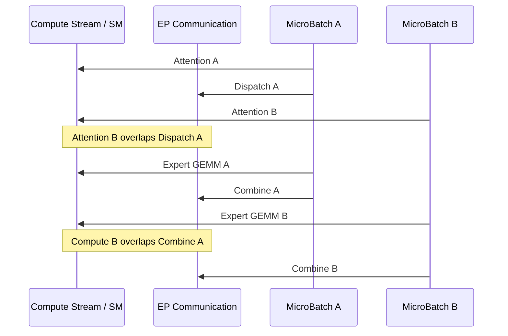

这与 DeepSeek 自己公开的 V3/R1 inference profile 思路一致：两个 micro-batches 让一边的计算隐藏另一边的 all-to-all；其 decode profile 使用 EP128、batch 128，并通过低 SM/异步通信来创造 overlap 空间。citeturn22search10

### Overlap 条件矩阵

| 技术 | 交叠对象 | 粒度 | 如何解除/隐藏依赖 | 是否需多请求 | batch/硬件要求 | 主要目标 | 已验证实现 |
|---|---|---|---|---|---|---|---|
| CPU-GPU overlap | scheduler ↔ forward | iteration | CPU 准备下一 step，GPU 执行当前 step | 否 | GPU work 足够长 | TPOT/吞吐 | vLLM/SGLang |
| H2D-compute | input/state transfer ↔ compute | tensor/layer | async memcpy + stream/event | 否 | DMA engine/独立 work | latency |
| AllReduce-compute | collective ↔ independent compute | layer/tensor | async collective，延迟 wait | 否 | 有独立计算 | latency/吞吐 |
| A2A-GEMM overlap | MoE communication ↔ expert/shared compute | layer | dispatch async + independent expert/shared work | 否 | EP + async comm | throughput |
| TBO | MB-A comm ↔ MB-B compute | micro-batch | split batch + yield/interleave | **不要求两个独立用户请求，但必须可形成两个 micro-batches** | workload 足够大；EP/comm 要可 overlap | 吞吐为主 | SGLang；vLLM 有 dual-batch variant citeturn25view3turn24view0 |
| SBO | 同一 batch comm ↔ shared/independent compute | batch/layer | 找单 batch 内无直接依赖工作 | 否 | 有 shared expert 等独立路径 | latency+吞吐 | SGLang citeturn25view4 |
| Pipeline overlap | stage A ↔ stage B | micro-batch/stage | micro-batch pipeline | 否 | 多 stage/device | throughput |
| PD pipeline | request-N prefill ↔ request-M decode | request/pool | 独立资源池 | 通常依赖 workload concurrency | 多 worker + KV transfer | TTFT/TPOT isolation | SGLang/TRT-LLM/others citeturn26view2 |
| KV transfer-compute | KV copy ↔ other compute | request/chunk | async transport + buffer | 通常是 | 网络需足够快 | TTFT/goodput |
| Spec pipeline | draft ↔ verify/prep | token/tree | 提前 proposal / async stage | 否 | acceptance 率关键 | latency |
| Kernel producer-consumer | load ↔ MMA | warp/kernel | warp specialization/TMA/PDL | 否 | Hopper/Blackwell 特征更强 | kernel latency | specialized kernels |

### TBO 对单请求的适用性

这是最容易被误解的一点。

**“Two-Batch”不等于“必须有两个用户请求”。**

真正需要的是：当前 token workload 可以被切成两个足够大的、合法的 micro-batches。SGLang 文档描述的是“splits requests into micro-batches”，不是要求两个独立 API 请求。citeturn25view3

因此：

**长单请求 Prefill：可能受益。** 一个长 sequence 中大量 prompt tokens 可以在合法条件下形成两个 token micro-batches；DeepSeek 官方 prefill profile 也说明同一 prompt 可以被两个 micro-batches 分割。citeturn22search10

**单请求、单 token Decode：通常很难受益于典型 TBO。** 只有一个 token 时，没有足够 token-level work 拆成两个有意义的 micro-batches。此时更适合 SBO、kernel overlap、stream overlap 或 scheduler/device overlap。

**小 batch Decode：收益容易变差。** 一旦拆成两份后每个 micro-batch 太小，GEMM efficiency 下降、launch/yield overhead 增大，隐藏的通信时间不足以补偿损失。

**大 batch MoE Decode：最典型。** DeepSeek 公布的 decode overlap profile 就采用较大 request batch 和高 EP degree。citeturn22search10

另外，TBO 与 CUDA Graph、speculation、hybrid attention 的组合不是自动成立；历史上 SGLang 也出现过 TBO/CUDA graph、EAGLE/hybrid model 相关兼容性限制或未完成路径，因此使用时必须以具体版本验证，而不是看到 `--enable-two-batch-overlap` 就假设所有模型可用。citeturn5search2turn5search9turn5search12

### 最重要的易混淆概念

| 对比 | 最关键区别 |
|---|---|
| **MLP vs FFN** | MLP 是广义网络结构；FFN 是 Transformer block 中 token-wise MLP |
| **FFN vs Gated MLP** | Gated MLP 多一条 projection/gate，并做乘法交互 |
| **Dense FFN vs MoE** | Dense 每 token 执行同一 FFN；MoE 只执行选中的 expert FFNs |
| **MHA vs MQA** | MQA 共享 KV heads；Q heads 不必减少 citeturn11academia25 |
| **MQA vs GQA** | MQA 通常一组 KV；GQA 多组 KV citeturn11academia24 |
| **GQA vs MLA** | GQA 改 KV head sharing；MLA 改 KV representation |
| **MLA vs DSA** | MLA 压缩“存什么”；DSA 稀疏“读哪些” citeturn0academia2turn1search0 |
| **Sparse vs Linear Attention** | Sparse 保留少量 token-token lookup；Linear 将历史聚合成 recurrent state |
| **GDN vs KDA** | KDA 是 Gated DeltaNet 谱系的细粒度 gating/update 扩展 citeturn7academia1turn27view3 |
| **Mamba vs Linear Attention** | 都可 recurrent decode，但数学 state transition 与训练/parallel form 不同 |
| **Residual vs HC** | Residual 是一条 stream；HC 是多 residual streams |
| **HC vs mHC** | mHC 对 mixing 加稳定性/流形约束 citeturn6academia0 |
| **FlashAttention vs Sparse Attention** | 前者优化 exact attention 的执行；后者减少 attention edges |
| **FlashAttention vs PagedAttention** | 前者解决 IO-efficient math；后者解决动态 KV layout/addressing |
| **FlashAttention vs FlashInfer** | FlashAttention 是算法/kernel family；FlashInfer 是 serving-oriented kernel library |
| **Continuous Batching vs Chunked Prefill** | 前者动态组请求；后者切分长 prefill |
| **Async Scheduling vs TBO** | 前者主要 host scheduler↔GPU；TBO 是 GPU micro-batch compute↔comm |
| **TBO vs PP** | TBO 同一模型 layer 内/附近 overlap；PP 是模型 layers 分 stage |
| **TBO vs CUDA Stream Overlap** | TBO 是 execution schedule；streams 是实现 overlap 的底层机制之一 |
| **TBO vs SBO** | TBO 借两个 micro-batches 创造独立工作；SBO 找单 batch 内天然独立工作 citeturn25view4 |
| **MTP vs Speculative Decoding** | MTP 是模型训练/结构能力；spec decoding 是推理算法，可把 MTP 当 drafter |
| **Medusa vs EAGLE** | Medusa 加多 prediction heads；EAGLE 主要在 feature space draft citeturn13academia14turn13academia12 |
| **TP vs EP** | TP 切 tensor computation；EP 切 experts |
| **CP vs DCP** | CP 泛指 sequence/context 切分；DCP 专门面向 decode/context state |
| **PD vs PP** | PD 按 inference phase 分 worker pools；PP 按 model layers 分 stage |
| **KV Compression vs KV Quantization** | compression 改表示/维度/条目；quantization 改数值精度 |
| **Prefix Cache vs Paged KV** | prefix cache 解决复用；paged KV 解决放置 |
| **CUDA Graph vs Piecewise Graph** | Full graph 要求执行路径稳定；piecewise 只 capture 稳定片段 |
| **Piecewise vs Breakable Graph** | Piecewise 预先划分 graph pieces；Breakable 强调动态断点/恢复 |
| **EP communication vs DeepEP** | EP 是并行策略；DeepEP 是针对 EP dispatch/combine 的通信实现 citeturn22search0 |
| **PD Disaggregation vs KV Offload** | PD 把计算阶段分机器；offload 只是把 cache 移至慢层级 |

## 学习路线与可维护知识库

### 一小时速览

按照以下依赖顺序即可建立 80% 的地图：

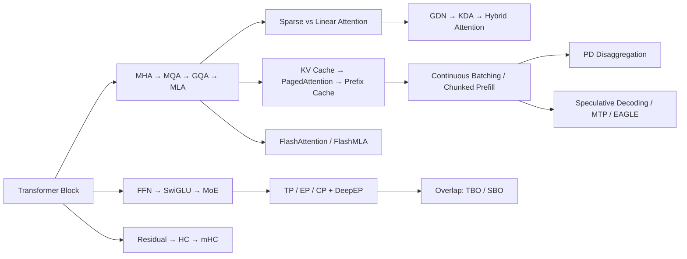

建议时间分配：

**前 15 分钟**只理解 MHA→GQA→MLA、Sparse vs Linear、GDN→KDA。

**再 10 分钟**理解 FFN→SwiGLU→MoE、Residual→HC→mHC。

**再 15 分钟**掌握 KV/PagedAttention/Radix、Continuous Batching、Chunked Prefill。

**再 10 分钟**理解 TP/EP/CP、DeepEP、TBO/SBO。

**最后 10 分钟**快速扫 Speculative Decoding、PD disaggregation 和 CUDA Graph。

一小时结束后，遇到新名词时应该首先能判断：“这是模型结构、state、kernel、parallelism、scheduler 还是 serving topology？”

### 一天 Catch-up

上午先建立现代模型结构坐标：

`Transformer → GQA → MLA → DSA → GDN/KDA → Hybrid Attention`

以及：

`FFN → SwiGLU → MoE → Fine-Grained/Shared Experts`

和：

`Residual → HC → mHC`

重点阅读 DeepSeek-V2、Gated DeltaNet、Kimi Linear/mHC 以及 Qwen3.5、DeepSeek-V4、GLM-5.3-Flash 的实际配置。citeturn0academia2turn7academia1turn27view3turn6academia0turn28view2turn27view0turn28view0

下午建立 inference runtime 坐标：

`Prefill/Decode → Roofline → Continuous Batching → Paged KV → Chunked Prefill → Prefix Cache → PD`

然后是：

`FlashAttention → CUDA Graph → Fusion → TP/EP/CP → DeepEP → Overlap`

最后再读：

`Classic Spec → Medusa → EAGLE → MTP → modern adaptive speculation`

PagedAttention、Orca、SGLang 和 DistServe 是这一段非常好的“系统坐标论文”。citeturn12academia0turn23search10turn12academia2turn23academia50

晚上直接浏览最新 vLLM/SGLang release notes，而不是继续看二手博客。当前 vLLM v0.31 与 SGLang v0.5.21 的 release notes 已经相当于一份“2026 inference engineering trend list”。citeturn24view0turn25view0

### 两周系统学习

第一阶段建立模型计算图：

```text
Transformer
 ├─ Attention
 │   ├─ GQA/MQA
 │   ├─ MLA
 │   ├─ Sparse
 │   └─ Linear/Recurrent
 ├─ FFN/SwiGLU
 ├─ MoE
 └─ Residual/Norm
```

目标是能手工读懂 `modeling_*.py` 和 `config.json`，看到 `num_key_value_heads`、`layer_types`、`n_routed_experts`、`hc_mult`、`index_topk`、`num_nextn_predict_layers` 时知道它们会如何改变 inference graph。DeepSeek-V4 的 Transformers config 是非常好的综合练习材料。citeturn27view0

第二阶段建立单卡 execution model：

```text
GEMM / GEMV
→ memory bandwidth
→ arithmetic intensity
→ FlashAttention
→ fused MLP
→ quantized GEMM
→ CUDA Graph
→ Triton/CUTLASS/CuTe
```

目标是能够回答一个 kernel 为什么快，而不是只会记 benchmark。

第三阶段建立 serving runtime：

```text
Request
→ Scheduler
→ Batch
→ KV allocator
→ Model Runner
→ Attention Backend
→ Sampling
→ Response
```

用 vLLM 的 PagedAttention/Model Runner 和 SGLang 的 Radix cache/runtime 做对照。citeturn12academia0turn12academia2turn24view0

第四阶段进入 distributed MoE：

```text
Router
→ Token permutation
→ Dispatch
→ All-to-All
→ Grouped GEMM
→ Combine
→ Residual
```

然后学习 TP/EP/CP、DeepEP、EPLB、TBO/SBO。DeepEP 当前官方代码已经把 asynchronous event 与 deferred epilogue 暴露为直接可观察的 overlap abstraction。citeturn22search0

第五阶段研究 2026 hybrid models：

`Qwen3.5 → GDN`

`Kimi Linear → KDA`

`GLM-5.3-Flash → KDA + KPool-DSA + mHC + MoE`

`DeepSeek-V4 → CSA/HCA + mHC + Hash-MoE`

此时再回头看 vLLM/SGLang 的对应 PR，会明显更容易理解为什么需要新的 state manager、attention backend 和 CUDA graph strategy。citeturn28view2turn27view3turn28view0turn27view0turn24view0turn25view0

最后再研究 speculative decoding 和 PD，因为这两类优化高度依赖前面已经理解的 KV/state、scheduler 和 execution model。

### 建议的长期知识库 Schema

真正适合长期维护的结构不应只有 `name → definition`，而至少应该表示**关系和证据**：

```yaml
id: attn.kda
name: Kimi Delta Attention
zh_name: Kimi Delta 注意力
category: architecture.linear_attention
year: 2025

summary: >
  Gated DeltaNet 谱系中的细粒度门控 recurrent attention，
  面向高效长上下文建模。

predecessors:
  - attn.delta_rule
  - attn.gated_deltanet

successors: []

related:
  - attn.linear_attention
  - state.recurrent
  - kernel.flash_kda
  - cache.hybrid_state

models:
  - Kimi Linear
  - GLM-5.3-Flash

engines:
  - vLLM
  - SGLang

maturity: frontier
priority: P1

evidence:
  - type: paper
    ref: Kimi Linear
  - type: implementation
    ref: FLA/KDA
  - type: release_note
    ref: SGLang v0.5.15-v0.5.21

relations:
  - type: improves
    target: attn.gated_deltanet
  - type: combined_with
    target: attn.mla
  - type: requires_runtime_support
    target: state.recurrent
```

关系类型建议固定为：

```text
inherits_from
improves
replaces
alternative_to
combined_with
depends_on
implemented_by
used_by_model
accelerated_by
incompatible_with
experimental_successor
```

尤其要避免把所有 relation 都写成模糊的 `related_to`。

### JSON 节点的推荐形式

```json
{
  "id": "overlap.tbo",
  "name": "Two-Batch Overlap",
  "category": "execution.overlap",
  "year": 2025,
  "summary": "将 workload 分成两个 micro-batch，以一个 micro-batch 的计算隐藏另一个的 MoE 通信。",
  "predecessors": [
    "overlap.compute_communication",
    "execution.microbatch"
  ],
  "related": [
    "parallel.expert_parallel",
    "communication.deepep",
    "overlap.single_batch"
  ],
  "engines": ["SGLang", "vLLM"],
  "optimization_target": ["throughput"],
  "granularity": ["micro_batch", "layer"],
  "requires_multiple_requests": false,
  "requires_multiple_microbatches": true,
  "maturity": "frontier",
  "priority": "P1"
}
```

### 可下载结构化样例

本次已生成两份可直接作为 Git 仓库种子的结构化文件，其中包含 schema 和第一批代表节点：

[下载 YAML 知识库样例](sandbox:/mnt/data/llm_inference_knowledge_graph_v1.yaml)

[下载 JSON 知识库样例](sandbox:/mnt/data/llm_inference_knowledge_graph_v1.json)

建议实际仓库进一步采用下面的目录：

```text
llm-inference-knowledge/
├── README.md
├── taxonomy/
│   ├── architecture.yaml
│   ├── attention.yaml
│   ├── ffn_moe.yaml
│   ├── residual_norm.yaml
│   ├── kernels.yaml
│   ├── kv_state.yaml
│   ├── scheduling.yaml
│   ├── distributed.yaml
│   ├── overlap.yaml
│   ├── speculative.yaml
│   └── quantization.yaml
├── models/
│   ├── deepseek.yaml
│   ├── qwen.yaml
│   ├── glm.yaml
│   ├── kimi.yaml
│   └── llama.yaml
├── engines/
│   ├── vllm.yaml
│   ├── sglang.yaml
│   ├── tensorrt_llm.yaml
│   └── llama_cpp.yaml
├── relations/
│   └── edges.csv
└── sources/
    ├── papers.yaml
    ├── releases.yaml
    └── prs.yaml
```

最值得长期维护的不是 `summary` 字段，而是四种时间：

```yaml
timeline:
  paper_proposed: 2025-10
  code_released: 2025-10
  engine_first_supported: 2026-07
  production_mature: null
```

以及四种证据：

```yaml
evidence_level:
  theory: true
  author_benchmark: true
  open_source_implementation: true
  independent_reproduction: false
```

这可以避免一个在当前 LLM 系统研究中非常常见的错误：

> **论文里提出 ≠ 开源代码能跑 ≠ 主流引擎能加载 ≠ 任意硬件都支持 ≠ 已经生产成熟。**

当前 2026 年的 release notes 更进一步证明了这种区分的重要性。例如 SGLang 的 KDA 支持经历了 kernel、MTP correctness、fused acceptance 等多个阶段；vLLM 的 DeepSeek-V4.1 支持则持续增加 FlashMLA、mHC fusion、Mega-Gate、DSpark 等专项路径；TensorRT-LLM 同样会明确记录 backend deprecation、known issues 和硬件范围。所谓“支持某模型/技术”，必须拆到 **model correctness、kernel path、CUDA graph、distributed mode、speculation、quantization、hardware** 七个维度才有工程意义。citeturn25view1turn24view0turn26view0turn26view2

从整个图谱看，2026 年最值得优先追踪的五条主线已经非常清楚：

**Hybrid Attention/State**：GDN、KDA、Sparse Softmax、SSM 开始共存。citeturn28view2turn28view0

**Compressed/Sparse Attention**：MLA 之后继续向 DSA、CSA/HCA、KPool 等方向发展。citeturn0academia2turn1search0turn27view0

**Residual topology**：HC/mHC 把过去几乎固定的 residual connection 重新变成模型设计变量。citeturn8academia25turn6academia0

**MoE communication + overlap**：优化中心从单个 expert GEMM 转向 EP、All-to-All、expert placement、DeepEP、TBO/SBO 的联合优化。citeturn22search0turn25view3turn25view4

**Model-aware serving runtime**：新的模型不再能被“一套标准 Transformer runtime”高效覆盖，vLLM、SGLang、TensorRT-LLM 都越来越多地出现针对 hybrid state、sparse indexer、mHC、MTP 和模型特定 communication path 的设计。citeturn24view0turn25view0turn26view1

这五条线正是从“熟悉 Transformer/vLLM”继续 catch up 到 2026 年 LLM inference engineering 的最短路径。
